# Arquitectura del sistema — Dentissa

**Commit analizado**: `9fcff4c635d5134d9f252b6158812c4dd15e2657` (`main`, 2026-09-02)
**Estilo arquitectónico**: monolito MVC en capas, renderizado íntegramente en servidor
**Profundidad del análisis**: Comprehensive

---

## 1. Visión general

Dentissa es un **monolito Laravel de un solo artefacto desplegable**. Un único `composer.json`, un único `package.json`, sin workspaces, sin submódulos, sin librerías internas y sin ningún límite de proceso dentro de la aplicación. Todo el código de aplicación vive en `app/` (2.545 líneas), toda la superficie HTTP en `routes/web.php` (161 líneas) y toda la presentación en `resources/views/` (37 plantillas Blade, 5.851 líneas).

La aplicación es una **MPA renderizada en servidor**: cada interacción es una navegación completa o un envío de formulario HTML con `@csrf`. No existe `routes/api.php`, ningún controlador devuelve JSON, y una búsqueda exhaustiva sobre las 37 plantillas no encontró ni una sola llamada `fetch()`, `axios` ni `XMLHttpRequest`. La única integración saliente es OAuth 2.0 contra Google.

### Corrección de dos hipótesis previas

Dos suposiciones que circulaban antes de este análisis son **falsas** y quedan corregidas aquí:

1. **La pila no es «Vite».** Es **Laravel `v12.62.0` sobre PHP `^8.2`** (imagen `php:8.4-fpm`) con **MariaDB**. Vite `8.0.1`, Tailwind `4.2.2` y axios `1.13.6` están instalados y declarados, pero **muertos**: la directiva `@vite` aparece exactamente una vez en las 37 plantillas, en `resources/views/welcome.blade.php`, y ninguna ruta renderiza `welcome` — la ruta raíz siempre redirige. El estilo real de la aplicación son 1.072 líneas de CSS artesanal servidas desde `public/css/`. Esa cadena inerte es, con toda probabilidad, la razón por la que una detección automática de framework reportó «Vite».
2. **El esquema no vive únicamente en una base de datos en ejecución.** Está **versionado** en `database/dentissa.sql`: un volcado de phpMyAdmin 5.2.1 contra MariaDB 10.4.32, de 671 líneas, fechado `05-07-2026`, con 17 tablas, 2 vistas SQL, 1 trigger, todos los índices, todas las claves foráneas y datos de ejemplo. `docker-compose.yml` lo monta en `/docker-entrypoint-initdb.d/` como script de inicialización. Lo que **sí** es cierto es que ese volcado está **desfasado** respecto al código; el mecanismo exacto se detalla en la sección 6.

---

## 2. Vista de despliegue

El entorno declarado es exclusivamente local, con cuatro contenedores. No existe ninguna definición de staging ni de producción en el repositorio.

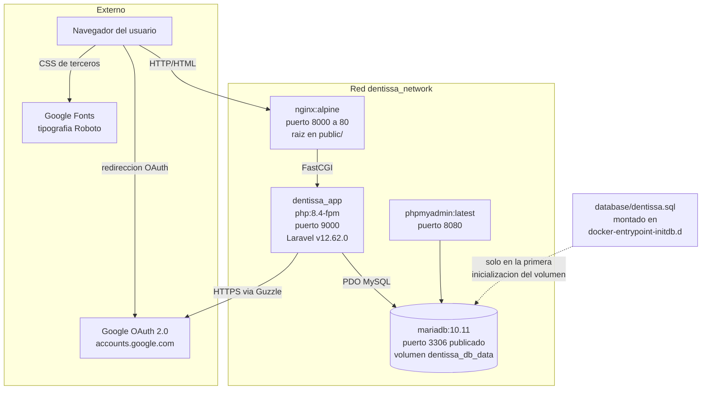

**Descripción textual del diagrama.** El navegador habla HTTP con `nginx`, que sirve los estáticos desde `public/` y delega los `.php` a `php-fpm` por FastCGI en el puerto `9000`. La aplicación Laravel habla con MariaDB por PDO y con Google por HTTPS a través de Guzzle. `phpmyadmin` está publicado en el `8080` con acceso a la base de datos. El volcado `database/dentissa.sql` se carga **una única vez**, cuando el volumen de datos se crea por primera vez. El navegador también carga la tipografía Roboto directamente desde Google Fonts, lo que constituye una dependencia externa en tiempo de ejecución.

**Riesgos de despliegue observados** (detallados en `code-quality-assessment.md`):

- El puerto `3306` está publicado al anfitrión y el servicio de base de datos permite contraseña vacía; phpMyAdmin está expuesto sin restricción de red.
- `docker-compose.yml` monta `./docker/php/local.ini`, pero el archivo real está en `docker/nginx/php/local.ini`. Docker crea un directorio vacío en su lugar, de modo que la zona horaria `America/Mexico_City` y los límites de memoria y subida **nunca se aplican**. Para un sistema de agenda, la zona horaria no aplicada es especialmente relevante.
- `.dockerignore` contiene una sola línea, por lo que la imagen copia `node_modules/` y `vendor/` del anfitrión si están presentes.

---

## 3. Vista de componentes

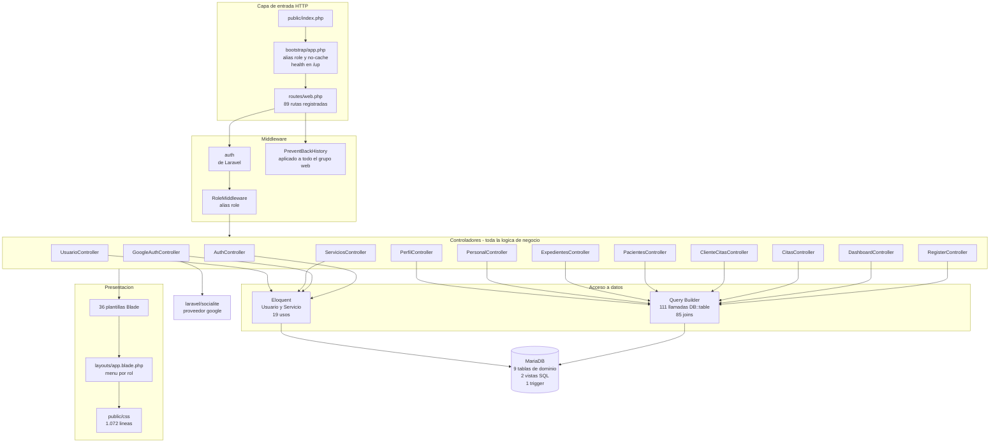

**Descripción textual del diagrama.** El punto de entrada único es `public/index.php`, que arranca la aplicación configurada en `bootstrap/app.php`. Allí se registran los dos middleware propios: `RoleMiddleware` con alias `role`, aplicado por grupo de rutas, y `PreventBackHistory` con alias `no-cache`, **añadido a todo el grupo `web`** e incluidas por tanto las páginas públicas de acceso y registro. `routes/web.php` reparte las peticiones a doce controladores concretos. Los controladores concentran la totalidad de la lógica de negocio y del acceso a datos: no hay servicios de dominio, ni repositorios, ni Form Requests, ni Policies, ni eventos, ni jobs. El acceso a datos es mayoritariamente query builder crudo (111 invocaciones de `DB::table`); Eloquent sólo participa a través de dos modelos. Toda respuesta es una vista Blade que extiende un layout común, estilizado por CSS artesanal servido directamente desde `public/`.

### 3.1 Estructura interna de `app/`

Sólo existen tres subdirectorios, y esa ausencia es en sí misma un dato arquitectónico:

```
app/
  Http/
    Controllers/   13 archivos, 1.972 lineas -- todo el dominio
    Middleware/     2 archivos,    48 lineas -- autorizacion y cabeceras
  Models/           3 archivos,    91 lineas -- Usuario, Servicio, User (muerto)
  Providers/        1 archivo,     24 lineas -- register() y boot() vacios
```

No hay `app/Services/`, `app/Repositories/`, `app/Policies/`, `app/Events/`, `app/Jobs/`, `app/Notifications/`, `app/Rules/` ni `app/Http/Requests/`. El dominio no tiene una capa propia: **vive dentro de los controladores**.

---

## 4. Modelo de datos

El modelo de datos es el artefacto más valioso que produce este análisis, porque no está documentado en ninguna otra parte del repositorio.

**Convenciones transversales**, verificadas en las 9 tablas de dominio:

- Clave primaria `char(36)` con `DEFAULT uuid()` generada por el motor, motor InnoDB, cotejamiento `utf8mb4_unicode_ci`.
- Marcas de tiempo en español: `creado_en` y `actualizado_en`, **no** las `created_at`/`updated_at` de Laravel. Por eso los tres modelos Eloquent declaran `public $timestamps = false`.
- Baja lógica mediante columnas `activo`, no borrado físico.

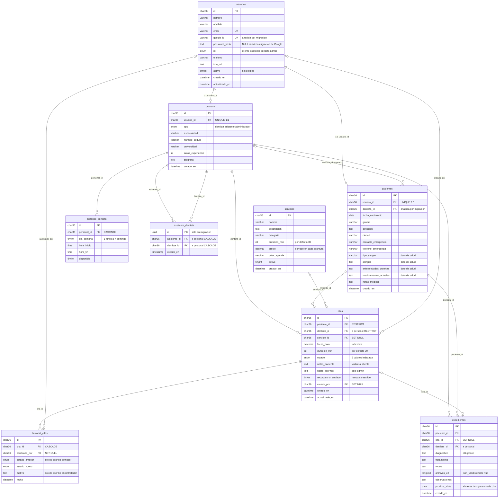

**Descripción textual del modelo.** `usuarios` es la identidad común de todos los actores. De ella cuelgan en relación uno a uno `pacientes` (perfil clínico) y `personal` (perfil profesional). **Todas las relaciones de agenda apuntan a `personal.id`, nunca a `usuarios.id`** — es el punto que más confusión provoca al leer el código. Una `cita` enlaza un paciente, un dentista de `personal`, opcionalmente un servicio y un instante con duración. `horarios_dentista` define la disponibilidad semanal recurrente que gobierna si esa cita puede existir. `expedientes` registra el resultado clínico de una consulta, opcionalmente ligado a la cita que lo originó. `historial_citas` es la bitácora de cambios de estado. `asistente_dentista` es la tabla puente que acota qué agenda ve cada asistente.

### 4.1 Índices y restricciones relevantes

| Objeto | Definición | Por qué importa |
| --- | --- | --- |
| `uq_usuarios_email` | UNIQUE sobre `usuarios.email` | Es la clave natural de acceso y de vinculación con Google |
| `idx_usuarios_rol` | Índice sobre `usuarios.rol` | Soporta los recuentos por rol de la administración |
| `idx_citas_fecha_estado` | Índice compuesto `(fecha_hora, estado)` | Es el índice que sostiene la detección de solapes y los paneles del día |
| UNIQUE `(personal_id, dia_semana)` | En `horarios_dentista` | Impide dos franjas para el mismo día, lo que fuerza un único intervalo continuo por día |
| `uq_asistente_dentista` | UNIQUE `(asistente_id, dentista_id)` | Impide asignaciones duplicadas |
| `citas.paciente_id` y `citas.dentista_id` | Claves foráneas **sin acción de borrado**, es decir `RESTRICT` | Un borrado físico de paciente con citas lanza una excepción SQL no capturada |

### 4.2 Objetos de base de datos con lógica

- **Trigger `trg_historial_cita`** (`AFTER UPDATE` sobre `citas`): si el estado cambia, inserta en `historial_citas` con `estado_anterior` y `estado_nuevo`. Es **lógica de negocio residente en la base de datos**, invisible desde el código de aplicación.
- **Vistas `v_citas_hoy` y `v_historial_paciente`**: definidas en la línea base y **nunca consultadas** por el PHP. Los controladores reconstruyen esos mismos cruces a mano.

---

## 5. Diagramas de interacción

Esta sección describe cómo se implementan las transacciones de negocio a través de los componentes. Es la respuesta directa a la pregunta «comprender el flujo».

### 5.1 Acceso local y despacho por rol

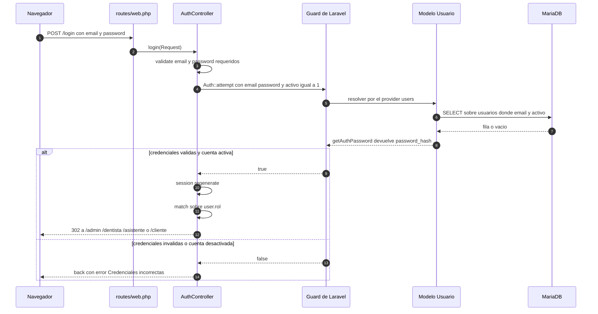

**Descripción textual.** El controlador valida el formulario, delega en el guard de Laravel y **añade `activo = 1` como tercera condición del intento**, de modo que una cuenta dada de baja no puede entrar y recibe el mismo mensaje genérico que una credencial errónea. El proveedor de autenticación apunta al modelo `Usuario` sobre la tabla `usuarios`; el redireccionamiento de la contraseña a la columna `password_hash` se hace sobrescribiendo `getAuthPassword()`. Tras regenerar la sesión, un `match` sobre el rol decide el destino. Esa misma expresión `match` está duplicada en la closure de la ruta raíz y en el callback de Google — tres copias de la misma regla de despacho.

### 5.2 Registro y acceso con Google en dos pasos

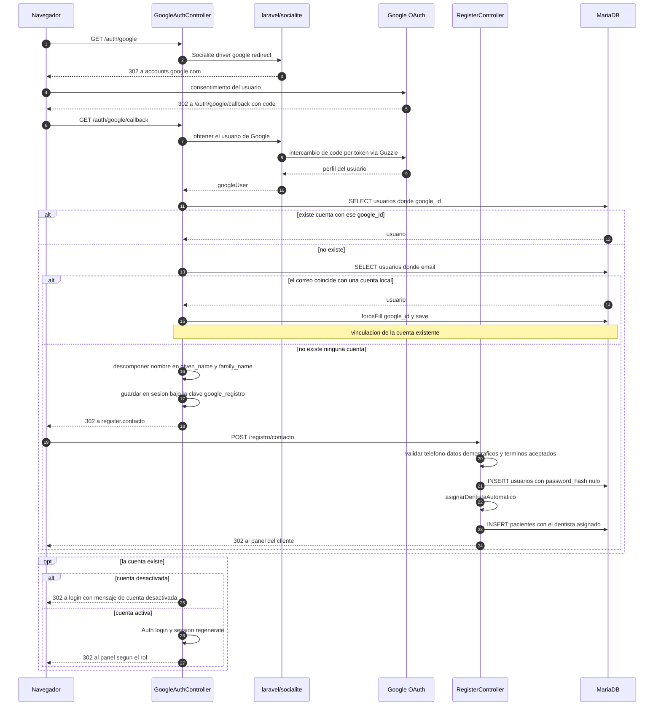

**Descripción textual.** El callback resuelve la identidad en tres intentos: primero por `google_id`, después por correo (y en ese caso **vincula** la cuenta local existente escribiendo el `google_id`), y si no encuentra nada **no crea el usuario todavía**. En su lugar guarda el perfil de Google en la sesión y exige un segundo paso de contacto que reclama teléfono, datos demográficos y aceptación explícita de términos. Sólo entonces se inserta el usuario, con `password_hash` nulo — que es exactamente lo que habilitó la migración `2026_07_18_195924` al relajar esa columna a `NULL`. El paciente recién creado recibe su dentista por el mismo balanceo automático que el registro directo. Una cuenta desactivada que intente entrar por Google recibe un mensaje explícito, a diferencia del acceso local, que devuelve el mensaje genérico.

### 5.3 Agendar una cita desde el personal — las tres comprobaciones

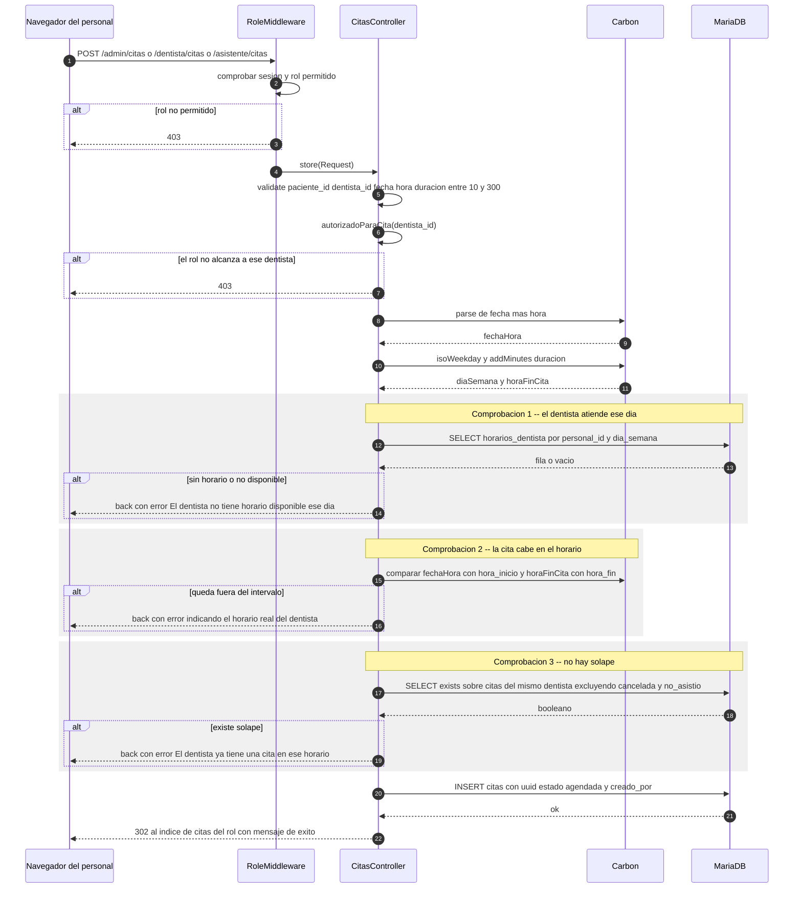

**Descripción textual.** La petición atraviesa primero `RoleMiddleware`, que exige sesión y rol permitido. El controlador valida el formulario y después reaplica el alcance por rol con `autorizadoParaCita()`, de modo que un dentista no puede agendar en la agenda de otro y un asistente sólo puede hacerlo para los dentistas que tiene asignados. A continuación se ejecutan las tres comprobaciones en orden, cada una con un mensaje de error propio y devolviendo el formulario con los datos introducidos. Sólo si las tres pasan se inserta la cita con estado inicial `agendada` y con `creado_por` apuntando al usuario autenticado.

**Limitación arquitectónica de este flujo**: entre la comprobación 3 y la inserción no hay transacción, ni bloqueo, ni restricción de unicidad en la base de datos que impida el solape. Dos peticiones concurrentes para el mismo hueco **pueden crear dos citas solapadas**. La corrección natural es envolver la comprobación y la inserción en una transacción con bloqueo, o añadir una restricción de exclusión a nivel de esquema.

### 5.4 Agendar una cita desde el cliente — dónde difiere

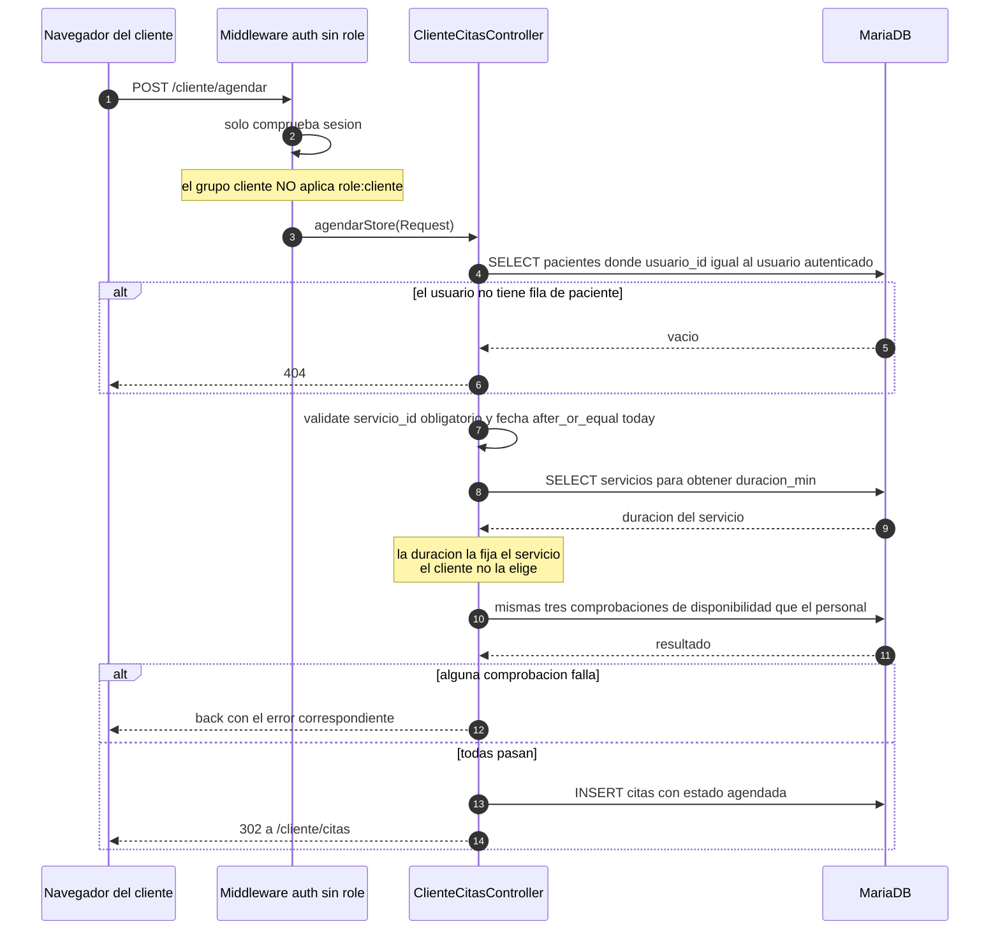

**Descripción textual.** El flujo del cliente ejecuta **la misma secuencia de tres comprobaciones**, pero implementada en un segundo lugar del código, con tres diferencias deliberadas: el servicio es obligatorio y determina la duración, la fecha no puede ser anterior a hoy, y el paciente se resuelve siempre desde la sesión en lugar de venir del formulario. La duplicación de la regla es la deuda técnica más costosa del proyecto: cualquier cambio en la política de disponibilidad debe aplicarse en dos sitios.

Obsérvese además que el grupo `cliente` es el único de los cuatro que **no** aplica `role:`; sólo exige sesión. La consecuencia real se documenta en `code-quality-assessment.md`, hallazgo `SEC-2`.

### 5.5 Ciclo de vida de la cita

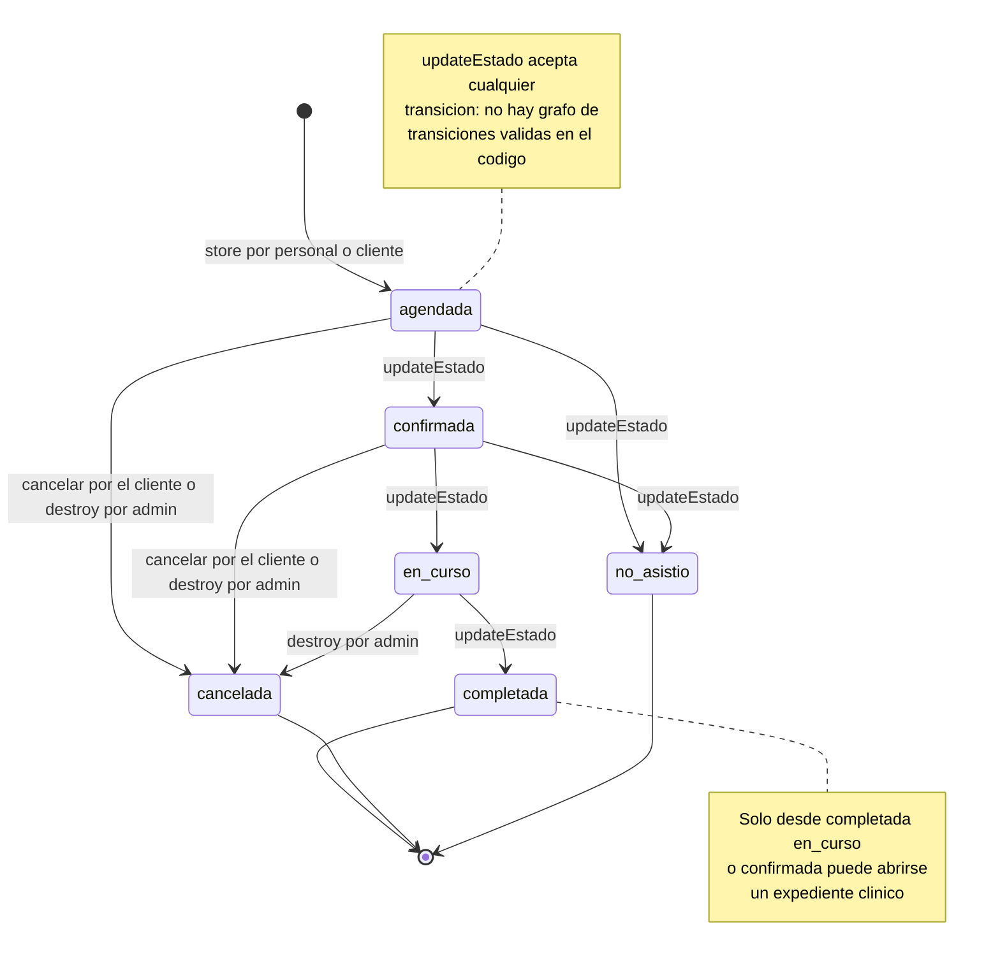

**Descripción textual.** El camino previsto es `agendada` a `confirmada` a `en_curso` a `completada`, con `cancelada` y `no_asistio` como salidas terminales. El diagrama refleja el flujo **intencionado**, pero el código no lo impone: la validación de `updateEstado` es únicamente `in:` sobre los seis valores del `enum`, sin ninguna comprobación de la transición. Un cambio de `completada` a `agendada` es aceptado hoy. Los estados `cancelada` y `no_asistio` tienen además un efecto de negocio: son los dos que la comprobación de solape excluye, de modo que una cita cancelada libera su hueco.

### 5.6 Cambio de estado y doble escritura del historial

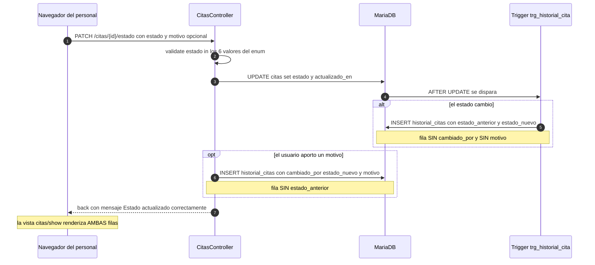

**Descripción textual.** Un solo cambio de estado con motivo produce **dos filas de bitácora, y ninguna de las dos es completa**: la del trigger conserva la transición pero pierde el autor y el motivo; la del controlador conserva el autor y el motivo pero pierde el estado anterior. La vista de detalle de la cita renderiza las dos, de modo que el usuario ve el cambio duplicado. El propio código reconoce la duplicidad en un comentario. Es un ejemplo claro de lógica repartida entre la base de datos y la aplicación sin un dueño único: la corrección arquitectónica pasa por elegir uno de los dos caminos y eliminar el otro.

### 5.7 Expediente clínico a partir de una cita

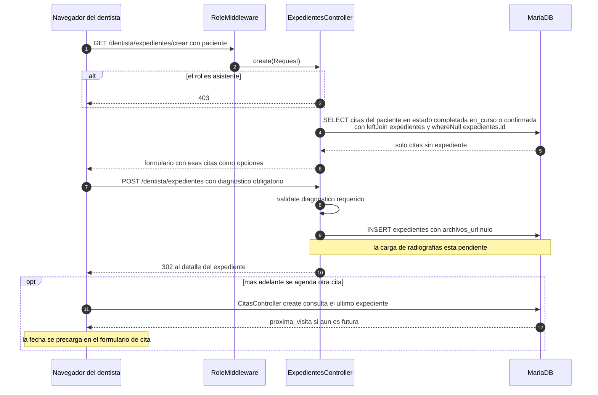

**Descripción textual.** El expediente sólo puede abrirse sobre una cita del paciente que aún no tenga expediente y que esté en un estado compatible con haber sido atendida. El asistente queda excluido con una respuesta `403` explícita en el servidor, no sólo ocultando el botón. El campo `archivos_url` se inserta siempre nulo: la carga de radiografías y documentos está declarada en el esquema pero no implementada. La `proxima_visita` cierra el círculo del dominio: al abrir el formulario de una nueva cita para ese paciente, el sistema precarga esa fecha si aún está en el futuro.

### 5.8 Sistema de roles y alcance de datos

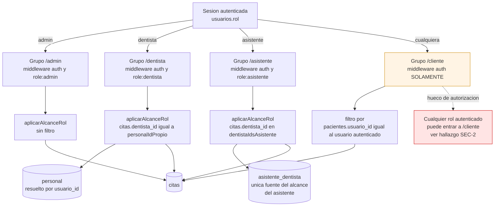

**Descripción textual.** La autorización descansa en dos piezas y sólo dos. La primera es el `enum` `usuarios.rol` combinado con `RoleMiddleware`, que gobierna el acceso a cada grupo de rutas. La segunda es el par de ayudantes `aplicarAlcanceRol()` y `autorizadoParaCita()` de `CitasController`, que acotan **qué filas** ve cada rol: el administrador no se filtra, el dentista se filtra por su propia fila de `personal`, y el asistente se filtra por la tabla puente `asistente_dentista` — que es literalmente lo único que define su alcance. El grupo `cliente` rompe el patrón: es el único que no aplica `role:`, de modo que cualquier usuario autenticado puede entrar en él.

---

## 5.9 Trazado de una petición completa

Recorrido de extremo a extremo, útil para orientarse en el código:

```
Navegador
  -> nginx (raiz en public/, delega .php por FastCGI al puerto 9000)
    -> public/index.php
      -> bootstrap/app.php (alias role y no-cache, grupo web, health en /up)
        -> routes/web.php (resolucion por orden de registro)
          -> middleware auth (guard web, provider users -> App\Models\Usuario)
          -> middleware role:<rol> (RoleMiddleware -> abort 403 o redirect a /login)
          -> Controlador (validacion inline + regla de negocio + DB::table)
            -> MariaDB (query builder; el trigger puede escribir por su cuenta)
          -> view(...) -> plantilla Blade -> @extends layouts.app
            -> menu por rol + panel de contrasena generada
            -> asset('css/app.css') con cadena de cache por filemtime
  <- HTML completo + cabeceras no-store de PreventBackHistory
```

---

## 6. El mecanismo de arranque del esquema

Este es el hallazgo operativo más importante del análisis, porque **no está documentado en ninguna parte del repositorio** y determina si el proyecto arranca o no.

```mermaid
graph TB
    subgraph Camino1["Camino A - composer setup - FALLA"]
        A1["composer install"] --> A2["copiar .env.example a .env"]
        A2 --> A3["artisan key:generate"]
        A3 --> A4["artisan migrate --force"]
        A4 --> A5["create_asistente_dentista_table<br/>declara claves foraneas contra personal"]
        A5 --> A6["ERROR: la tabla personal no existe<br/>ninguna migracion la crea"]
    end

    subgraph Camino2["Camino B - docker compose up - FUNCIONA"]
        B1["docker compose up"] --> B2["MariaDB inicializa el volumen"]
        B2 --> B3["ejecuta /docker-entrypoint-initdb.d/dentissa.sql"]
        B3 --> B4["17 tablas 2 vistas 1 trigger<br/>y datos de ejemplo"]
        B4 --> B5["la tabla migrations llega YA POBLADA<br/>con las 3 migraciones de andamiaje"]
        B5 --> B6["artisan migrate posterior las salta<br/>y aplica solo las 3 de julio de 2026"]
        B6 --> B7["Esquema efectivo:<br/>volcado MAS las 3 migraciones"]
    end

    style A6 fill:#ffe4e4,stroke:#cc0000
    style B7 fill:#e4ffe4,stroke:#00aa00
    style B5 fill:#fff4e4,stroke:#cc8800
```

**Descripción textual.** Las migraciones de `database/migrations/` **crean** únicamente el andamiaje de Laravel y la tabla puente `asistente_dentista`. Las otras dos migraciones de 2026-07 **alteran** tablas que ninguna migración crea: una añade `usuarios.google_id`, otra añade `pacientes.dentista_id`. Contra una base de datos vacía, `artisan migrate` aborta en la creación de `asistente_dentista`, porque declara claves foráneas contra `personal`, que no existe. Por tanto **el guion `composer setup` no funciona**.

El único camino que funciona es Docker, y funciona por una coincidencia: `docker-compose.yml` monta el volcado como script de inicialización, y el volcado incluye la tabla `migrations` **ya poblada** con las tres migraciones de andamiaje. Un `artisan migrate` posterior las considera aplicadas, las salta y ejecuta sólo las tres de julio de 2026.

**El esquema efectivo es, por tanto, «el volcado más las tres migraciones de julio de 2026».** El volcado por sí solo carece de `usuarios.google_id`, de `pacientes.dentista_id` y de la tabla `asistente_dentista` — es decir, carece de la autenticación con Google, del dentista asignado al paciente y de todo el alcance del rol asistente.

**Consecuencia adicional verificada**: el volcado no siembra **ninguna** fila de `horarios_dentista`. Tras un arranque limpio, la comprobación 1 de la agenda falla para cualquier fecha, y **no puede crearse ninguna cita** hasta que un administrador guarde el horario semanal de un dentista. El volcado tampoco siembra ningún usuario con rol `asistente`.

---

## 7. Decisiones de arquitectura observadas (ADR retrospectivos)

Las siguientes decisiones no están documentadas en el repositorio; se reconstruyen a partir de la evidencia del código. El estado es `Accepted` en el sentido de «vigente en el código», no de «aprobada formalmente».

### ADR-001 — Monolito Laravel MVC con Blade renderizado en servidor

**Status**: Accepted (vigente en el código)

**Context**. Equipo de cuatro autores, 25 commits, dominio único y acotado (una clínica), sin necesidad declarada de despliegue independiente ni de escalado por módulo. La aplicación debe entregar pantallas completas a cuatro tipos de usuario.

**Decision**. Un único artefacto desplegable Laravel `v12.62.0`, con toda la interfaz renderizada en servidor mediante Blade y navegación por formularios HTML. Sin capa de API, sin cliente JavaScript.

**Consequences**. Se gana simplicidad extrema de despliegue, depuración y razonamiento: una petición, un controlador, una vista. Se pierde la posibilidad de reutilizar la lógica desde un cliente móvil o desde integraciones externas sin construir antes una capa de API. Además, al no existir contrato HTTP formal, **cualquier prueba automatizada del dominio debe pasar por el ciclo completo de petición**, lo que hace más caro escribir pruebas y contribuye a que hoy no exista ninguna.

**Alternatives Rejected**.
- *API JSON con cliente JavaScript (SPA)*: descartada de facto. Las dependencias de esa alternativa están instaladas (Vite, Tailwind, axios) pero no se usan; la evidencia sugiere que se partió del esqueleto por defecto de Laravel y se abandonó ese camino. Habría añadido complejidad de estado en el cliente sin beneficio para un flujo de formularios.
- *Monolito modular con módulos separados por contexto*: no se adoptó. Habría requerido definir fronteras entre agenda, expediente e identidad, un coste que no se justifica con cuatro autores, pero que sería el siguiente paso natural si el sistema crece.

### ADR-002 — Autorización por `enum` de rol en middleware, sin Policies ni Gates

**Status**: Accepted

**Context**. Cuatro roles con alcances de datos claramente distintos. Laravel ofrece Gates y Policies como mecanismo idiomático de autorización por recurso.

**Decision**. La autorización se resuelve en dos niveles: `RoleMiddleware` aplicado por grupo de rutas decide **si se entra**, y dos ayudantes privados de `CitasController` deciden **qué filas se ven**. No se usan Policies ni Gates.

**Consequences**. El control es legible y está en un solo sitio para las citas, que es el recurso crítico. A cambio, la regla no es reutilizable: `PacientesController` y `ExpedientesController` reimplementan su propio control con `abort(403)` en línea, y dos acciones de `CitasController` (`updateNotas` y `destroy`) **no invocan** el ayudante y dependen únicamente de estar dentro del grupo `admin`. La ausencia de un mecanismo declarativo también significa que no hay un lugar único donde auditar la política de acceso.

**Alternatives Rejected**.
- *Policies de Laravel por modelo*: habrían dado un punto único de autorización por recurso y son verificables en aislamiento, pero exigen modelos Eloquent para cada entidad, y el proyecto sólo tiene dos.
- *Paquete de roles y permisos de terceros*: habría añadido tablas de permisos granulares. Descartado por sobredimensionado para cuatro roles fijos codificados en un `enum`.

### ADR-003 — Acceso a datos con query builder dentro de los controladores

**Status**: Accepted

**Context**. El esquema es previo al código y usa convenciones que no son las de Laravel (claves UUID generadas por el motor, marcas de tiempo en español). Modelar cada tabla con Eloquent habría exigido configurar cada modelo.

**Decision**. El acceso a datos se hace con `DB::table(...)` directamente en los controladores: 111 invocaciones y 85 cruces, con sólo dos modelos Eloquent (`Usuario` y `Servicio`) para los casos que el framework necesita.

**Consequences**. Se gana control total sobre el SQL generado y se evita la fricción de mapear un esquema no idiomático. Se pierde reutilización: la consulta base de citas está duplicada casi íntegra en cuatro lugares, y el ayudante de dentistas disponibles está copiado literalmente en dos controladores. Cualquier cambio de esquema obliga a buscar todas las copias. Además, **la lógica de negocio queda inseparable de la capa HTTP**, lo que impide probarla sin levantar una petición.

**Alternatives Rejected**.
- *Modelos Eloquent completos para las 9 tablas de dominio*: habrían dado relaciones declarativas y reutilización, a cambio de configurar en cada modelo la clave UUID no incremental, `$timestamps = false` y los nombres de columna en español. Es un coste único y modesto frente a la duplicación actual.
- *Repositorios sobre query builder*: habrían centralizado las consultas sin adoptar el ORM. Es la vía de refactorización de menor riesgo desde el estado actual.

### ADR-004 — Claves primarias UUID `char(36)` generadas por el motor

**Status**: Accepted

**Context**. Sistema con datos sensibles cuyos identificadores viajan en la URL (`/admin/pacientes/{id}`).

**Decision**. Todas las tablas de dominio usan `char(36)` con `DEFAULT uuid()`, resuelto por MariaDB. En el lado de la aplicación, los modelos usan `HasUuids` y los controladores generan el UUID explícitamente antes de insertar.

**Consequences**. Los identificadores no son enumerables, lo que elimina de raíz la fuga de información por conteo y dificulta el acceso directo por adivinación de identificador. A cambio, `char(36)` es un índice ancho y **el `enum` de rol y las claves foráneas quedan atados a MariaDB**: la sintaxis `DEFAULT uuid()` no es portable, lo que contribuye directamente a que la suite de pruebas configurada con SQLite en memoria no pueda levantar el esquema.

**Alternatives Rejected**.
- *Enteros autoincrementales*: más compactos y portables, pero enumerables en la URL de un sistema con datos de salud.
- *UUID binarios de 16 bytes*: índice más estrecho, pero ilegibles al depurar y sin soporte cómodo en phpMyAdmin, que es la herramienta de administración elegida.

### ADR-005 — Volcado SQL versionado como línea base, migraciones sólo para el delta

**Status**: Accepted, pero **con consecuencias no resueltas**

**Context**. El esquema se diseñó en phpMyAdmin antes de escribir el código. Reescribirlo como migraciones habría costado tiempo al inicio del proyecto.

**Decision**. Versionar el volcado completo `database/dentissa.sql` como línea base y usar migraciones sólo para los cambios posteriores (las tres de julio de 2026). `docker-compose.yml` carga el volcado como script de inicialización.

**Consequences**. Se ganó velocidad inicial. Se perdió la reproducibilidad del esquema: `composer setup` **falla** contra una base de datos vacía; el arranque sólo funciona por Docker y por una coincidencia no documentada (la tabla `migrations` llega ya poblada en el volcado). Además, el volcado **arrastra datos personales reales** al repositorio y a la historia de git, y **el entorno de pruebas queda inutilizable** porque SQLite no puede ejecutar la sintaxis del volcado. Es la decisión con mayor coste acumulado del proyecto.

**Alternatives Rejected**.
- *Migraciones desde el principio*: habrían dado un esquema reproducible en cualquier motor y un entorno de pruebas viable, a cambio de reescribir el diseño hecho en phpMyAdmin.
- *Volcado sólo de estructura, con seeders separados para los datos*: habría conservado la velocidad inicial sin versionar datos personales. Es la corrección de menor esfuerzo desde el estado actual y debería adoptarse.

### ADR-006 — Tabla puente `asistente_dentista` como mecanismo de alcance del asistente

**Status**: Accepted

**Context**. Un asistente no debe ver toda la agenda de la clínica, sino sólo la de los dentistas con los que trabaja. La relación es de muchos a muchos.

**Decision**. Una tabla puente entre dos filas de `personal`, con restricción única sobre el par, mantenida por `PersonalController` con el patrón de borrar e insertar, y consultada por `CitasController::dentistaIdsAsistente()` para acotar todas las consultas del asistente.

**Consequences**. El alcance del asistente es explícito, auditable y modificable desde la interfaz. El riesgo es de disponibilidad de la función, no de seguridad: un asistente sin filas en la tabla **no ve absolutamente nada** y el sistema no se lo explica. Y como la tabla sólo existe en migración y no en el volcado, **un entorno que no aplique las migraciones deja el rol asistente sin funcionar**.

**Alternatives Rejected**.
- *Columna única `dentista_id` en `personal`*: más simple, pero limita a un asistente a un solo dentista, lo que no refleja la operación real de una clínica.
- *Alcance por especialidad o por sede*: no hay concepto de sede en el modelo y la especialidad es texto libre, de modo que no ofrece una frontera fiable.

### ADR-007 — Borrado lógico como patrón por defecto

**Status**: Accepted, aplicado de forma inconsistente

**Context**. Datos clínicos con requisitos de conservación y claves foráneas restrictivas.

**Decision**. Las bajas se hacen con marcas `activo` (`toggleActivo` en pacientes y personal) y la «eliminación» de una cita es un cambio de estado a `cancelada`.

**Consequences**. Se preserva la historia clínica y se evitan las violaciones de integridad referencial. **La inconsistencia es que `UsuarioController::destroy()` sí borra físicamente**, y por las claves foráneas del volcado eso propaga borrado en cascada a `pacientes` y a `personal` — perdiendo el expediente asociado — mientras que `citas.paciente_id` es restrictivo, de modo que borrar un paciente con citas lanza una excepción SQL no capturada y devuelve un error `500`.

**Alternatives Rejected**.
- *Borrado físico uniforme*: incompatible con la conservación de historia clínica.
- *Columna `deleted_at` con el rasgo `SoftDeletes` de Laravel*: es el mecanismo idiomático y filtraría automáticamente las consultas, pero exige modelos Eloquent para todas las tablas, que el proyecto no tiene.

### ADR-008 — Trigger de base de datos para la bitácora de estados

**Status**: Accepted, **en conflicto con el código de aplicación**

**Context**. Se necesita trazabilidad de los cambios de estado de una cita, con garantía de que ninguna escritura se pierda.

**Decision**. Un trigger `AFTER UPDATE` sobre `citas` inserta en `historial_citas` cuando el estado cambia.

**Consequences**. La bitácora es infalsificable desde la aplicación y captura también los cambios hechos directamente en la base de datos. Pero el trigger **no puede conocer el usuario autenticado ni el motivo**, de modo que el controlador inserta una segunda fila para aportarlos. El resultado es doble escritura con dos filas incompletas por cada cambio, ambas renderizadas en la interfaz.

**Alternatives Rejected**.
- *Bitácora escrita sólo por la aplicación*: fila única y completa con autor, motivo y transición, a cambio de perder los cambios hechos fuera de la aplicación. Es la opción recomendada dado que el único acceso directo previsto es phpMyAdmin en desarrollo.
- *Trigger enriquecido con una variable de sesión de MariaDB para el usuario*: técnicamente posible, pero acopla la aplicación a una característica del motor y complica las pruebas.

### ADR-009 — CSS artesanal servido desde `public/` en lugar de la cadena Vite

**Status**: Accepted de facto (la cadena declarada quedó inerte)

**Context**. El esqueleto de Laravel incluye Vite y Tailwind. El equipo escribió su propia hoja de estilos.

**Decision**. 1.072 líneas de CSS artesanal en `public/css/`, enlazadas desde el layout con una cadena de invalidación de caché basada en la marca de tiempo del fichero. Vite, Tailwind y axios permanecen instalados y declarados pero sin consumidor.

**Consequences**. No hay paso de construcción para desplegar el frontend, lo que simplifica el despliegue. A cambio, no hay minificación ni empaquetado, y **la presencia de una cadena de construcción muerta desorienta el diagnóstico** — hasta el punto de que una detección automática identificó el proyecto como «Vite» en lugar de Laravel. Además, el layout invoca `filemtime()` en cada render, lo que supone un acceso al sistema de ficheros por petición.

**Alternatives Rejected**.
- *Adoptar la cadena Vite y Tailwind ya instalada*: habría dado minificación y versionado de assets, a cambio de reescribir 1.072 líneas de CSS.
- *Eliminar Vite, Tailwind y axios del proyecto*: es la opción de menor coste y mayor claridad si se confirma que no se van a usar. Elimina seis dependencias y la ambigüedad de la pila.

### ADR-010 — Vocabulario de dominio en español sobre andamiaje en inglés

**Status**: Accepted

**Context**. Equipo y usuarios hispanohablantes. El framework impone nombres en inglés en su andamiaje.

**Decision**. Todo el dominio en español —tablas, columnas, rutas, variables, mensajes de validación, vistas— con marcas de tiempo `creado_en` y `actualizado_en` y `$timestamps = false` en los modelos.

**Consequences**. El código es directamente legible por los interesados del negocio y coincide con el lenguaje ubicuo real de la clínica. El coste es una frontera de traducción permanente: el par `users` frente a `usuarios` deja **dos tablas de usuarios coexistiendo**, un modelo `App\Models\User` sin ninguna referencia en la aplicación, una fábrica y un seeder que siembran en la tabla equivocada, y un defecto latente en el almacenamiento de sesiones cuya columna `user_id` es un entero mientras que `usuarios.id` es un UUID.

**Alternatives Rejected**.
- *Todo en inglés*: habría eliminado la frontera, a costa de alejar el código del lenguaje del negocio.
- *Dominio en español con eliminación del andamiaje inglés no usado*: es la corrección recomendada. Borrar `App\Models\User`, `UserFactory`, el seeder y la tabla `users` elimina la ambigüedad sin renunciar al vocabulario del negocio.

---

## 8. Evaluación arquitectónica

### 8.1 Fortalezas

| Fortaleza | Evidencia |
| --- | --- |
| **Regla de agenda genuinamente elaborada** | Tres comprobaciones encadenadas con mensajes de error específicos, y el uso correcto del día ISO de la semana, coherente con el comentario de la propia columna |
| **Alcance de datos por rol centralizado para el recurso crítico** | `aplicarAlcanceRol()` y `autorizadoParaCita()` aplicados en cuatro acciones de `CitasController` |
| **Defensa en profundidad en el expediente** | El asistente queda excluido tanto en el servidor con `403` como en la interfaz con guardas por rol — no basta con ocultar el botón |
| **Baja lógica como patrón dominante** | `activo` en usuarios, pacientes y personal; cancelación en lugar de borrado en citas |
| **Integridad referencial declarada en el esquema** | Claves foráneas con acciones de borrado explícitas y un índice compuesto que soporta la consulta más cara |
| **Vocabulario ubicuo real** | El código habla el idioma del negocio, lo que reduce la distancia entre el interesado y la implementación |
| **Alta de personal con contraseña generada** | Patrón bien ejecutado: se genera, se muestra una única vez con aviso explícito y con botón de copiado |

### 8.2 Debilidades estructurales

| Debilidad | Impacto | Dónde se detalla |
| --- | --- | --- |
| **La regla de agenda está duplicada en dos controladores** | Cualquier cambio de política debe aplicarse dos veces; ya divergen en tres puntos | `code-quality-assessment.md`, `TD-5` |
| **No hay capa de dominio** | La lógica es inseparable de HTTP, lo que hace caro probarla y contribuye a la cobertura cero | `TD-5` |
| **Lógica repartida entre base de datos y aplicación sin dueño** | Doble escritura del historial con filas incompletas | `TD-7` |
| **Sin transacción ni bloqueo en la creación de citas** | Dos peticiones concurrentes pueden crear un solape real | `TD-19` |
| **El esquema no es reproducible por migraciones** | `composer setup` falla; el entorno de pruebas es inviable | `TD-1` |
| **Dos tablas de usuarios coexistentes** | Andamiaje muerto que induce a error y un defecto latente de sesiones | `TD-3`, `TD-4` |
| **El grupo `cliente` no verifica el rol** | Un miembro del personal que guarde su perfil de cliente se crea un registro de paciente espurio | `SEC-2` |
| **Cadena de assets muerta** | Desorienta el diagnóstico de la pila y arrastra seis dependencias sin uso | `TD-9` |

### 8.3 Oportunidades de mejora, por relación coste-beneficio

1. **Escribir las migraciones que faltan para las 9 tablas de dominio, y reducir el volcado a datos anonimizados.** Desbloquea a la vez la reproducibilidad del entorno, la posibilidad de escribir pruebas y la retirada de los datos personales del repositorio. Es la única acción que resuelve tres problemas de raíz a la vez.
2. **Extraer la regla de agenda a un único servicio de dominio**, invocado por los dos controladores, y envolver la comprobación y la inserción en una transacción. Elimina la duplicación y cierra la ventana de concurrencia.
3. **Corregir los dos defectos funcionales confirmados** (`DEF-1` y `DEF-2`): son cambios de una y dos líneas respectivamente y hoy rompen funcionalidad visible.
4. **Elegir un único dueño para la bitácora de estados** y eliminar el otro camino de escritura.
5. **Añadir `role:cliente` al grupo `cliente`** y sustituir la inserción implícita de `PerfilController` por una comprobación explícita.
6. **Eliminar el andamiaje muerto**: `App\Models\User`, `UserFactory`, el seeder, la tabla `users`, y las dependencias de Vite, Tailwind y axios si se confirma que no se usarán.
7. **Introducir repositorios o modelos Eloquent completos** para retirar las 111 llamadas de query builder de los controladores. Es la refactorización de mayor alcance y debe ir después de que existan pruebas.

---

## Sources

- `bootstrap/app.php`, `public/index.php`, `routes/web.php`, `routes/console.php`
- `app/Http/Controllers/` — los 13 controladores; `app/Http/Middleware/` — los 2 middleware; `app/Models/` — los 3 modelos; `app/Providers/AppServiceProvider.php`
- `database/dentissa.sql` — 671 líneas: `CREATE TABLE` de 17 tablas, definición de 2 vistas, trigger `trg_historial_cita`, índices, claves foráneas y bloques `INSERT`
- `database/migrations/` — las 6 migraciones
- `docker-compose.yml`, `Dockerfile`, `docker/nginx/dentissa.conf`, `docker/nginx/php/local.ini`
- `composer.json`, `composer.lock`, `package.json`, `package-lock.json`, `vite.config.js`, `phpunit.xml`
- `config/auth.php`, `config/services.php`, `config/database.php`, `config/session.php`
- `resources/views/layouts/app.blade.php` y el barrido estructural de las 37 plantillas
- Escaneo del desarrollador: `aidlc/spaces/default/intents/260902-docs-sistema-dental/inception/reverse-engineering/developer-scan.md`
