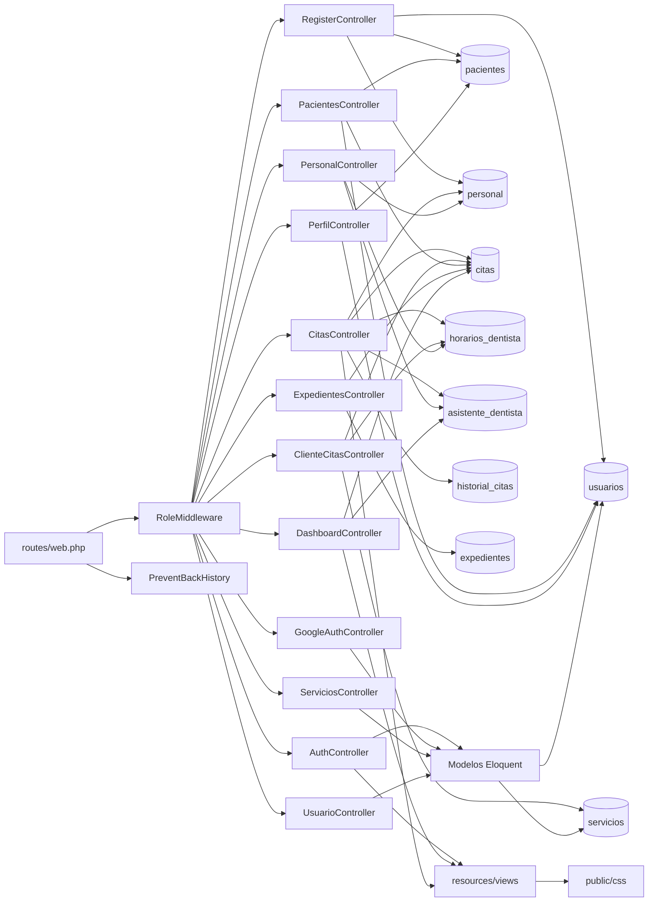

# Inventario de componentes — Dentissa

**Commit analizado**: `9fcff4c635d5134d9f252b6158812c4dd15e2657` (`main`, 2026-09-02)
**Total de componentes catalogados**: 23

---

## Cómo leer este inventario

El sistema es un **monolito de un solo artefacto desplegable**: los «componentes» de este inventario son módulos lógicos dentro de ese artefacto, no unidades desplegables por separado. Cada ficha declara la responsabilidad, las dependencias entrantes y salientes, las tablas que toca y una **valoración de salud**:

| Valoración | Significado |
| --- | --- |
| `Sano` | Responsabilidad clara, sin defectos conocidos, sin duplicación relevante |
| `En riesgo` | Funciona, pero acumula deuda que lo hará frágil ante el próximo cambio |
| `Degradado` | Contiene un defecto confirmado, un hueco de seguridad o está muerto |

---

## Mapa de dependencias

**Descripción textual del mapa.** Todas las peticiones entran por `routes/web.php` y atraviesan `RoleMiddleware` (salvo las públicas y el grupo `cliente`, que sólo pasa por `auth`). Los doce controladores concretos acceden a los datos por dos caminos: la mayoría escribe SQL directamente contra las tablas mediante el query builder, y sólo cuatro (`AuthController`, `GoogleAuthController`, `ServiciosController`, `UsuarioController`) pasan por los modelos Eloquent. Toda respuesta se renderiza en `resources/views`, que a su vez enlaza el CSS servido desde `public/css`. **No hay ninguna capa entre los controladores y la base de datos.**

---

## Componentes de autenticación e identidad

### AuthController

- **Archivo**: `app/Http/Controllers/AuthController.php` (50 líneas)
- **Responsabilidad**: acceso local con correo y contraseña, cierre de sesión y despacho al panel del rol.
- **Métodos públicos**: `loginForm`, `login`, `logout`
- **Depende de**: guard `web` de Laravel, `Modelos Eloquent` (a través del proveedor `users`), vista `auth/login`
- **Le depende**: `routes/web.php` (3 rutas públicas)
- **Regla que implementa**: `BRN-1` — añade `'activo' => 1` como tercera condición del intento de autenticación, de modo que una cuenta desactivada no puede entrar.
- **Salud**: `Sano`. Pequeño, claro y con la única regla de negocio bien colocada. Único reparo menor: la expresión `match` de despacho por rol está duplicada aquí, en `GoogleAuthController` y en la closure de la ruta raíz.

### GoogleAuthController

- **Archivo**: `app/Http/Controllers/GoogleAuthController.php` (63 líneas)
- **Responsabilidad**: flujo OAuth 2.0 con Google — redirección al proveedor y resolución de identidad en el retorno.
- **Métodos públicos**: `redirect`, `callback`
- **Depende de**: `laravel/socialite` `v5.28.0`, `guzzlehttp/guzzle`, `config/services.php`, `Modelos Eloquent`, sesión
- **Le depende**: `routes/web.php` (2 rutas públicas), `RegisterController` (consume la clave de sesión `google_registro`)
- **Contrato de resolución**: por `google_id`, luego por `email` con vinculación, y si no existe cuenta, derivación al segundo paso de registro sin crear nada.
- **Salud**: `En riesgo`. La lógica de resolución es correcta y bien pensada, pero **el callback no captura ninguna excepción**: un consentimiento cancelado, un `code` caducado o una indisponibilidad de Google producen un error genérico del servidor en lugar de un mensaje de negocio.

### RegisterController

- **Archivo**: `app/Http/Controllers/RegisterController.php` (179 líneas)
- **Responsabilidad**: registro directo del paciente y segundo paso del registro iniciado por Google.
- **Métodos públicos**: `showForm`, `register`, `contactoForm`, `contactoStore`
- **Método privado**: `asignarDentistaAutomatico(): ?string`
- **Tablas**: `usuarios` (2), `pacientes` (2), `personal` (1)
- **Depende de**: `Illuminate\Validation\Rules\Password`, `DB::transaction`, sesión, `Modelos Eloquent` para el inicio de sesión automático
- **Le depende**: `routes/web.php` (4 rutas públicas), `GoogleAuthController`
- **Regla que implementa**: `BRN-2` — el balanceo de dentistas por número de pacientes a cargo, con desempate por antigüedad. Es la única lógica de asignación del sistema y está correctamente aislada en un método privado.
- **Salud**: `Sano`. Es el controlador mejor construido del proyecto: valida con mensajes en español, envuelve las dos inserciones en una transacción y aísla la regla de asignación. Es el modelo a seguir para refactorizar los demás.

### RoleMiddleware

- **Archivo**: `app/Http/Middleware/RoleMiddleware.php` (28 líneas)
- **Responsabilidad**: control de acceso de entrada por rol. Alias `role`.
- **Comportamiento**: redirige a `/login` si no hay sesión; responde `403` si `usuarios.rol` no está entre los roles permitidos.
- **Depende de**: sesión de Laravel, columna `usuarios.rol`
- **Le depende**: tres de los cuatro grupos de `routes/web.php`
- **Salud**: `En riesgo`. El componente en sí es correcto y minúsculo. El riesgo es de uso: **el grupo `cliente` no lo aplica**, y esa omisión tiene consecuencias reales de escritura (ver `PerfilController` y el hallazgo `SEC-2`).

### PreventBackHistory

- **Archivo**: `app/Http/Middleware/PreventBackHistory.php` (20 líneas)
- **Responsabilidad**: añadir cabeceras `Cache-Control: no-store`, `Pragma: no-cache` y `Expires` en el pasado, para impedir que el botón de retroceso muestre páginas de una sesión cerrada.
- **Depende de**: nada
- **Le depende**: `bootstrap/app.php`, que lo añade **a todo el grupo `web`**
- **Salud**: `En riesgo`. La intención es correcta, pero el alcance es excesivo: se aplica también a las páginas públicas de acceso y registro, desactivando la caché del navegador de forma global. Aplicarlo sólo a los grupos autenticados sería equivalente en seguridad y menos costoso.

---

## Componentes de agenda

### CitasController

- **Archivo**: `app/Http/Controllers/CitasController.php` (398 líneas)
- **Responsabilidad**: **el componente central del sistema.** Agenda desde la perspectiva del personal: listado con alcance por rol, creación con validación de disponibilidad, detalle, transiciones de estado y cancelación.
- **Métodos públicos**: `index`, `create`, `store`, `show`, `updateEstado`, `updateNotas`, `destroy`
- **Métodos privados**: `queryBase`, `personalIdPropio`, `dentistaIdsAsistente`, `aplicarAlcanceRol`, `autorizadoParaCita`
- **Tablas**: `citas` (31 accesos en todo el proyecto, la mayoría aquí), `personal`, `horarios_dentista`, `asistente_dentista`, `historial_citas`, `pacientes`, `servicios`, `expedientes`
- **Depende de**: `nesbot/carbon` (aritmética de fechas: `isoWeekday`, `addMinutes`, comparaciones), query builder, trigger `trg_historial_cita` de la base de datos
- **Le depende**: los grupos `admin`, `dentista` y `asistente` de `routes/web.php`; `DashboardController` reproduce su consulta base
- **Reglas que implementa**: `BRN-4`, `BRN-5`, `BRN-6`, `BRN-9`, `BRN-10`, `BRN-15`
- **Salud**: `En riesgo`. Contiene la lógica más valiosa y mejor pensada del sistema, y es además el único lugar donde el alcance por rol está centralizado. Los riesgos son cuatro:
  1. Las tres comprobaciones de disponibilidad están **duplicadas** en `ClienteCitasController`.
  2. `updateNotas()` y `destroy()` **no invocan** `autorizadoParaCita()`; dependen sólo de estar en el grupo `admin`.
  3. Entre la comprobación de solape y la inserción **no hay transacción ni bloqueo**, lo que deja una ventana de concurrencia real.
  4. `updateEstado()` acepta cualquier transición entre los seis estados.

### ClienteCitasController

- **Archivo**: `app/Http/Controllers/ClienteCitasController.php` (204 líneas)
- **Responsabilidad**: agenda desde la perspectiva del paciente: sus citas, detalle, cancelación y auto-agendado.
- **Métodos públicos**: `index`, `show`, `cancelar`, `agendarForm`, `agendarStore`
- **Método privado**: `pacienteActual`
- **Tablas**: `citas` (6), `horarios_dentista` (1), `servicios` (2), `pacientes` (1), `personal` (1)
- **Depende de**: `nesbot/carbon`, sesión, query builder
- **Le depende**: el grupo `cliente` de `routes/web.php`
- **Reglas que implementa**: `BRN-4`, `BRN-5`, `BRN-6` (copia), `BRN-7`, `BRN-8`
- **Salud**: `En riesgo`. Filtra correctamente por el paciente de la sesión y responde `404` cuando no hay fila, lo que mitiga el hueco de autorización de su grupo para la lectura. Pero **reimplementa la regla de agenda completa**, y las dos copias ya divergen en tres puntos (obligatoriedad del servicio, origen de la duración y fecha mínima). Es la duplicación más costosa del proyecto.

### PersonalController

- **Archivo**: `app/Http/Controllers/PersonalController.php` (422 líneas — el mayor del proyecto)
- **Responsabilidad**: gestión del personal, **definición de horarios semanales** y **asignación de dentistas a asistentes**.
- **Métodos públicos**: `index`, `create`, `store`, `show`, `edit`, `update`, `toggleActivo`, `saveHorarios`, `misDoctores`
- **Métodos privados**: `dentistasDisponibles`, `sincronizarDoctoresAsignados`
- **Tablas**: `personal` (10), `asistente_dentista` (7), `usuarios` (4), `citas` (4), `horarios_dentista` (3)
- **Le depende**: el grupo `admin` y la ruta `asistente.doctores`
- **Reglas que implementa**: `BRN-14`, `BRN-16`
- **Papel crítico**: es el **único** componente que escribe en `horarios_dentista` y en `asistente_dentista`, es decir, el único que alimenta la comprobación 1 de la agenda y el único que define el alcance del asistente. Sin él, ni las citas ni el rol asistente funcionan.
- **Salud**: `En riesgo`. Tres motivos: traduce a mano entre `usuarios.rol` (`admin`) y `personal.tipo` (`administrador`) con un `match` duplicado en `store()` y en `update()`; `saveHorarios()` fija siempre `disponible = 1`, de modo que el valor `0` sólo puede llegar por escritura manual en la base de datos; y `dentistasDisponibles()` está copiado literalmente en `PacientesController`.

---

## Componentes clínicos y de pacientes

### PacientesController

- **Archivo**: `app/Http/Controllers/PacientesController.php` (337 líneas)
- **Responsabilidad**: alta, edición, ficha y baja lógica de pacientes, con su historia clínica.
- **Métodos públicos**: `index`, `create`, `store`, `show`, `edit`, `update`, `toggleActivo`
- **Método privado**: `dentistasDisponibles`
- **Tablas**: `pacientes` (9), `citas` (4), `usuarios` (4), `personal` (1), `expedientes` (1)
- **Le depende**: los grupos `admin`, `dentista` (índice, ficha, edición) y `asistente` (índice, alta, ficha)
- **Reglas que implementa**: `BRN-14`, `BRN-16`
- **Salud**: `En riesgo`. Funciona correctamente y aplica la baja lógica, pero contiene el ayudante duplicado con `PersonalController` y bloques con la indentación colapsada a la columna 0.

### ExpedientesController

- **Archivo**: `app/Http/Controllers/ExpedientesController.php` (197 líneas)
- **Responsabilidad**: expediente clínico por consulta — creación a partir de una cita, consulta y edición.
- **Métodos públicos**: `index`, `create`, `store`, `show`, `update`
- **Tablas**: `expedientes` (4), `personal` (3), `citas` (1), `pacientes` (1)
- **Le depende**: el grupo `dentista` (los 5), el grupo `admin` (4, sin índice) y el grupo `asistente` (sólo `show`)
- **Reglas que implementa**: `BRN-11`, `BRN-12`
- **Salud**: `Sano`. Es el componente con mejor control de acceso del proyecto: excluye al asistente con `abort(403)` explícito en el servidor **además** de ocultarlo en la interfaz — defensa en profundidad real. La consulta que ofrece sólo citas sin expediente previo, mediante cruce a la izquierda y comprobación de nulo, está bien construida. Único punto pendiente: `archivos_url` se inserta siempre nulo, es decir, la carga de radiografías está declarada pero no implementada.

### PerfilController

- **Archivo**: `app/Http/Controllers/PerfilController.php` (102 líneas)
- **Responsabilidad**: edición del perfil y cambio de contraseña del cliente.
- **Métodos públicos**: `edit`, `update`, `updatePassword`
- **Tablas**: `pacientes` (4), `usuarios` (2)
- **Le depende**: el grupo `cliente`
- **Salud**: `Degradado`. La validación es correcta y usa `Password::min(8)` y `unique` sobre el correo. El problema es estructural: **`update()` inserta una fila en `pacientes` cuando no encuentra una para el usuario actual.** Combinado con la ausencia de `role:cliente` en su grupo, eso significa que un `admin`, un `dentista` o un `asistente` que guarde `/cliente/perfil` **se crea a sí mismo un registro de paciente espurio**. Ver hallazgo `SEC-2`.

---

## Componentes de administración

### DashboardController

- **Archivo**: `app/Http/Controllers/DashboardController.php` (232 líneas)
- **Responsabilidad**: los cuatro paneles de entrada, uno por rol.
- **Métodos públicos**: `admin`, `dentista`, `asistente`, `cliente`
- **Tablas**: `citas` (9), `personal` (3), `asistente_dentista` (1), `pacientes` (1), `usuarios` (1)
- **Le depende**: la ruta raíz de cada uno de los cuatro grupos
- **Salud**: `En riesgo`. Los cuatro métodos son correctos y el de `asistente` maneja bien el caso de no tener dentistas asignados devolviendo colecciones vacías. El riesgo es la duplicación: **la consulta base de citas de `CitasController` está reproducida casi íntegra en `admin()` y en `asistente()`**, de modo que un cambio en el modelo de citas obliga a tocar al menos tres lugares.

### UsuarioController

- **Archivo**: `app/Http/Controllers/UsuarioController.php` (116 líneas)
- **Responsabilidad**: administración de cuentas de usuario — listado con búsqueda y filtro por rol, ficha, alta, edición y borrado.
- **Métodos públicos**: `index`, `show`, `create`, `store`, `edit`, `update`, `destroy`
- **Depende de**: `Modelos Eloquent` (usa `Usuario` en lugar de query builder, a diferencia del resto)
- **Le depende**: el grupo `admin`
- **Salud**: `Degradado`. Acumula tres problemas confirmados:
  1. **Su ruta de alta responde `404`** por el orden de registro en `routes/web.php` (defecto `DEF-1`), de modo que el botón «Nuevo Usuario» de la interfaz no funciona.
  2. Es **el único controlador que no valida nada**: sin unicidad del correo y sin restricción sobre `rol`, siendo `rol` un campo asignable en masa. Asigna además una contraseña genérica escrita en el código.
  3. `destroy()` hace **borrado físico**, rompiendo el patrón de baja lógica del resto del sistema y provocando cascadas destructivas o excepciones SQL no capturadas según el caso.

  Además, su registro de comentarios es didáctico y numerado, en contraste con el resto del código: señal de autoría distinta y de menor revisión.

### ServiciosController

- **Archivo**: `app/Http/Controllers/ServiciosController.php` (71 líneas)
- **Responsabilidad**: catálogo de tratamientos.
- **Métodos públicos**: `index`, `create`, `store`, `edit`, `update`, `destroy` — **no tiene `show`**, pese a que `Route::resource` registra esa ruta
- **Depende de**: `Modelos Eloquent` (`Servicio`, el único modelo Eloquent de dominio)
- **Le depende**: el grupo `admin`; `CitasController` y `ClienteCitasController` leen la tabla `servicios` directamente
- **Salud**: `Degradado`. Contiene el defecto `DEF-2`: **fija `precio = 0` incondicionalmente en `store()` y en `update()`**, de modo que editar cualquier servicio borra su precio en silencio. `store()` fuerza además `color_agenda` al valor por defecto, anulando la paleta por servicio. Y `destroy()` hace borrado físico, lo que con la clave foránea `SET NULL` de `citas.servicio_id` desvincula las citas históricas de su servicio.

---

## Componentes de datos y modelo

### Modelos Eloquent

- **Archivos**: `app/Models/Usuario.php` (38), `app/Models/Servicio.php` (21), `app/Models/User.php` (32)
- **Responsabilidad**: mapeo objeto-relacional para los dos casos en que el framework lo exige.
- **`Usuario`**: extiende `Authenticatable`, usa `HasUuids` y `Notifiable`, apunta a la tabla `usuarios`, declara `$timestamps = false`, oculta `password_hash` y **sobrescribe `getAuthPassword()`** para redirigir la contraseña de Laravel a la columna `password_hash`. Es el proveedor de autenticación declarado en `config/auth.php`.
- **`Servicio`**: usa `HasUuids`, `$timestamps = false`, con `id` incluido entre los campos asignables en masa.
- **`User`**: **código muerto.** Ningún archivo de `app/`, `routes/`, `config/` ni `resources/` lo referencia.
- **Salud**: `En riesgo`. Los dos modelos en uso están bien configurados para un esquema no idiomático. El riesgo es la coexistencia con `User` y la tabla `users`, que induce a error y arrastra un defecto latente de sesiones (`TD-4`). Además, `Usuario` declara `rol` como campo asignable en masa sin ninguna validación en `UsuarioController`, lo que convierte esa combinación en un riesgo de elevación de privilegios.

### database/dentissa.sql

- **Archivo**: `database/dentissa.sql` (671 líneas)
- **Responsabilidad**: **la línea base real del esquema.** Volcado de phpMyAdmin 5.2.1 contra MariaDB 10.4.32, fechado `05-07-2026`. Contiene 17 tablas, 2 vistas SQL, 1 trigger, todos los índices, todas las claves foráneas y datos de ejemplo.
- **Contiene lógica de negocio**: el trigger `trg_historial_cita` (`AFTER UPDATE` sobre `citas`) inserta en `historial_citas` cuando cambia el estado. Es lógica invisible desde el código de aplicación.
- **Le depende**: `docker-compose.yml`, que lo monta en `/docker-entrypoint-initdb.d/`
- **Salud**: `Degradado`. Es el artefacto más valioso del repositorio para entender el dominio y a la vez el más problemático:
  1. **Está desfasado**: le faltan `usuarios.google_id`, `pacientes.dentista_id` y la tabla `asistente_dentista`.
  2. **Contiene datos personales sensibles y credenciales** (hallazgo `SEC-1`).
  3. **No siembra ninguna fila de `horarios_dentista`**, de modo que tras un arranque limpio no puede agendarse ninguna cita.
  4. **No siembra ningún usuario con rol `asistente`**, de modo que ese rol no puede ejercitarse sin crearlo antes.
  5. Su sintaxis específica de MariaDB impide levantar el esquema en el motor que la suite de pruebas configura.

### database/migrations

- **Archivos**: 6 migraciones
- **Responsabilidad**: crear el andamiaje de Laravel y aplicar el delta posterior al volcado.
- **Contenido**: tres migraciones de andamiaje (`users`, `cache`, `jobs`) y tres de julio de 2026 — `add_google_id_to_usuarios_table` (añade `google_id` y relaja `password_hash` a nulo), `create_asistente_dentista_table` y `add_dentista_id_to_pacientes_table`.
- **Salud**: `Degradado`. **Ninguna migración crea las 9 tablas de dominio.** Dos de las tres migraciones de 2026 alteran tablas que ninguna migración crea. Contra una base de datos vacía, `artisan migrate` aborta al crear `asistente_dentista`, porque declara claves foráneas contra `personal`. El esquema efectivo es «el volcado más estas tres migraciones», una composición que sólo funciona porque el volcado incluye la tabla `migrations` ya poblada, y que **no está documentada en ninguna parte**.

---

## Componentes de presentación

### routes/web.php

- **Archivo**: `routes/web.php` (161 líneas)
- **Responsabilidad**: toda la superficie HTTP. **89 rutas registradas** en cinco bloques: público, `admin` (43), `dentista` (15), `asistente` (12) y `cliente` (9).
- **Le depende**: todo el sistema
- **Rotación**: es el archivo con más cambios del repositorio — tocado en 7 de los 25 commits.
- **Salud**: `Degradado`. Contiene los dos problemas de enrutado del sistema: el orden que rompe el alta de usuarios (`DEF-1`) y la ruta duplicada con closure muerta. Además, es donde se materializa el hueco de autorización del grupo `cliente` (`SEC-2`).

### resources/views

- **Directorio**: `resources/views/` — 37 plantillas Blade en 11 carpetas, 5.851 líneas
- **Responsabilidad**: toda la presentación. `layouts/app.blade.php` (260 líneas) construye el menú por rol, renderiza el panel de contraseña generada y enlaza el CSS.
- **Depende de**: `public/css`, Google Fonts (tipografía cargada en tiempo de ejecución desde un dominio externo)
- **Propiedades verificadas en las 37 plantillas**: todos los formularios llevan `@csrf`; **no hay ni una sola salida sin escapar**; no hay ninguna llamada AJAX; el JavaScript en línea de 8 plantillas es enteramente vanilla y de interfaz.
- **Salud**: `En riesgo`. La disciplina de escapado y de CSRF es buena. Los reparos: la anidación de layouts en las tres plantillas de edición, que extienden el layout e incluyen una vista `create` que **también** lo extiende; y un `
` sin abrir en el bloque del logo del layout. **Nota de cobertura**: 6 plantillas se leyeron íntegras y las 37 se verificaron por barrido estructural; las 30 restantes no se leyeron línea a línea, de modo que este inventario **no afirma nada sobre su maquetación ni su accesibilidad**.

### public/css

- **Directorio**: `public/css/` — `app.css`, `auth.css`, `citas.css`, 1.072 líneas
- **Responsabilidad**: **el estilo real de toda la aplicación.** Servido directamente por nginx, sin paso de construcción.
- **Le depende**: `layouts/app.blade.php` y siete plantillas más, con una cadena de invalidación de caché calculada por `filemtime()` en cada render.
- **Salud**: `En riesgo`. Funciona y evita un paso de construcción, pero no hay minificación ni empaquetado, la llamada a `filemtime()` supone un acceso al sistema de ficheros por petición, y su coexistencia con una cadena Tailwind muerta desorienta el diagnóstico. **Nota de cobertura**: sólo se verificó su existencia, su tamaño y el hecho de que el layout las carga; **el detalle de las reglas no se analizó**.

### Cadena de assets Vite

- **Archivos**: `vite.config.js`, `resources/js/app.js`, `resources/js/bootstrap.js`, `resources/css/app.css`, `package.json`
- **Responsabilidad declarada**: empaquetar CSS y JavaScript con Vite `8.0.1` y Tailwind `4.2.2`, y exponer `axios` como `window.axios`.
- **Responsabilidad real**: **ninguna.** La directiva `@vite` aparece exactamente una vez en las 37 plantillas, en `welcome.blade.php`, y ninguna ruta renderiza esa vista.
- **Salud**: `Degradado` — componente muerto. Arrastra seis dependencias de npm sin consumidor y es la causa probable de que una detección automática identificara el proyecto como «Vite» en lugar de Laravel. Retirarlo, o adoptarlo de verdad, es la decisión pendiente.

---

## Componentes de infraestructura y calidad

### Infraestructura Docker

- **Archivos**: `Dockerfile`, `docker-compose.yml`, `docker/nginx/dentissa.conf`, `docker/nginx/php/local.ini`, `.dockerignore`
- **Responsabilidad**: entorno de desarrollo local con cuatro servicios — `app` (`php:8.4-fpm`), `nginx:alpine`, `db` (`mariadb:10.11`) y `phpmyadmin:latest`.
- **Salud**: `Degradado`. Es el **único** camino de arranque que funciona, lo que lo vuelve crítico, pero acumula cuatro defectos:
  1. `docker-compose.yml` monta `./docker/php/local.ini` mientras el archivo real está en `docker/nginx/php/local.ini`; Docker crea un directorio vacío y **la configuración de PHP nunca se aplica**, incluida la zona horaria — especialmente relevante en un sistema de agenda.
  2. `.env.example` declara un usuario de base de datos que el servicio `db` no crea.
  3. El puerto `3306` está publicado al anfitrión, se permite contraseña vacía y phpMyAdmin queda expuesto sin restricción de red.
  4. `.dockerignore` tiene una sola línea, de modo que la imagen copia `node_modules/` y `vendor/` del anfitrión si están presentes. La etiqueta `phpmyadmin:latest` además no es reproducible.

### tests

- **Directorio**: `tests/` — `TestCase.php`, `Unit/ExampleTest.php`, `Feature/ExampleTest.php`
- **Responsabilidad declarada**: suite de pruebas con PHPUnit `12.5.30`, suites `Unit` y `Feature` configuradas en `phpunit.xml`.
- **Responsabilidad real**: ninguna. Sólo contiene el andamiaje por defecto de Laravel.
- **Salud**: `Degradado`. **La cobertura efectiva sobre las 2.545 líneas de `app/` es cero**, no hay configuración de cobertura ni umbral, y **la única prueba de integración existente falla hoy**: afirma que `GET /` responde `200`, cuando la aplicación siempre devuelve una redirección. Además, el entorno de prueba está configurado con un motor de base de datos que no puede ejecutar el esquema del volcado, de modo que escribir pruebas de dominio **está bloqueado** hasta que existan migraciones reales.

---

## Resumen de salud

| Valoración | Componentes | Total |
| --- | --- | --- |
| `Sano` | `AuthController`, `RegisterController`, `ExpedientesController` | **3** |
| `En riesgo` | `GoogleAuthController`, `RoleMiddleware`, `PreventBackHistory`, `CitasController`, `ClienteCitasController`, `PersonalController`, `PacientesController`, `DashboardController`, `Modelos Eloquent`, `resources/views`, `public/css` | **11** |
| `Degradado` | `PerfilController`, `UsuarioController`, `ServiciosController`, `database/dentissa.sql`, `database/migrations`, `routes/web.php`, `Cadena de assets Vite`, `Infraestructura Docker`, `tests` | **9** |

**Lectura del resumen.** Los tres componentes sanos son los que tienen una responsabilidad estrecha y una regla de negocio bien aislada. Los once en riesgo funcionan pero acumulan duplicación o alcance excesivo. De los nueve degradados, cuatro lo están por un defecto confirmado (`PerfilController`, `UsuarioController`, `ServiciosController`, `routes/web.php`), tres por problemas del ciclo de vida del esquema y del entorno (`database/dentissa.sql`, `database/migrations`, `Infraestructura Docker`), uno por estar muerto (`Cadena de assets Vite`) y uno por no cumplir su propósito (`tests`).

**Concentración de riesgo**: `routes/web.php`, `database/dentissa.sql` y `CitasController` son los tres componentes con más dependientes. Cualquier plan de saneamiento debería empezar por ellos.

---

## Sources

- `app/Http/Controllers/` — los 13 archivos leídos íntegros; recuento de accesos por tabla extraído mecánicamente de cada archivo
- `app/Http/Middleware/RoleMiddleware.php`, `app/Http/Middleware/PreventBackHistory.php`
- `app/Models/Usuario.php`, `app/Models/Servicio.php`, `app/Models/User.php`
- `routes/web.php`, `bootstrap/app.php`, `bootstrap/providers.php`
- `database/dentissa.sql` (estructura, trigger, vistas y bloques `INSERT`), `database/migrations/`, `database/seeders/`, `database/factories/`
- `resources/views/` — barrido estructural de las 37 plantillas, lectura íntegra de 6
- `public/css/` — existencia y tamaño verificados; reglas no analizadas
- `Dockerfile`, `docker-compose.yml`, `docker/nginx/dentissa.conf`, `docker/nginx/php/local.ini`, `.dockerignore`
- `tests/`, `phpunit.xml`, `composer.json`
- Escaneo del desarrollador: `aidlc/spaces/default/intents/260902-docs-sistema-dental/inception/reverse-engineering/developer-scan.md`
