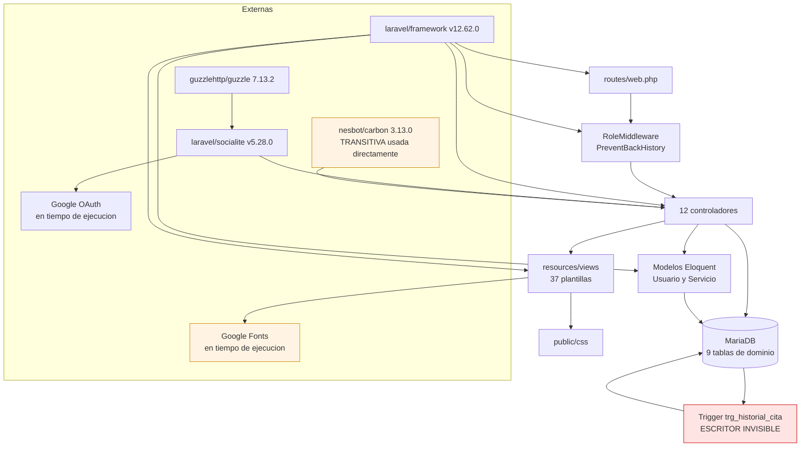

# Dependencias — Dentissa

**Commit analizado**: `9fcff4c635d5134d9f252b6158812c4dd15e2657` (`main`, 2026-09-02)

---

## 1. Estructura de paquetes

**No hay dependencias entre paquetes internos, porque sólo existe un paquete.** El repositorio es un monolito con un único `composer.json` y un único `package.json`, sin workspaces, sin submódulos, sin repositorios de rutas locales y sin librerías internas publicadas. Todo lo que este documento llama «dependencia interna» es acoplamiento **entre módulos lógicos** dentro de ese único artefacto desplegable.

Consecuencia práctica: **no existe ninguna frontera de compilación que impida a cualquier parte del código llamar a cualquier otra.** Las fronteras que existen son convencionales, no forzadas por la herramienta.

---

## 2. Dependencias externas de producción

### 2.1 Declaradas en `composer.json`

| Paquete | Versión resuelta | Superficie de uso en el código | Riesgo si desaparece |
| --- | --- | --- | --- |
| `laravel/framework` | `v12.62.0` | Todo el sistema | Total |
| `laravel/socialite` | `v5.28.0` | Sólo `GoogleAuthController` (2 métodos) | **Alto**: se pierde todo el registro y acceso con Google. La superficie de contacto es pequeña, lo que facilitaría un reemplazo |
| `laravel/tinker` | `v3.0.2` | Ninguna en el código de aplicación | Nulo |

### 2.2 Transitivas que el código usa directamente

Estas son las dependencias más frágiles del proyecto, porque **se usan sin estar declaradas**.

| Paquete | Versión resuelta | Quién lo trae | Uso directo en el código | Riesgo |
| --- | --- | --- | --- | --- |
| `nesbot/carbon` | `3.13.0` | `laravel/framework` | **`use Carbon\Carbon;` explícito** en `CitasController` y `ClienteCitasController`. Sostiene `isoWeekday()`, `addMinutes()` y las comparaciones de solape — es decir, **toda la regla de agenda** | **Alto.** Una futura versión de Laravel que cambiara su librería de fechas rompería la lógica de negocio central sin previo aviso. Debería declararse explícitamente en `composer.json` |
| `guzzlehttp/guzzle` | `7.13.2` | `laravel/socialite` | Indirecto, a través de Socialite | Bajo |
| `league/oauth1-client` | `v1.11.0` | `laravel/socialite` | Ninguno | Nulo |

**Total resuelto en `composer.lock`**: 325 paquetes, contando producción y desarrollo con todas sus transitivas.

### 2.3 Dependencias externas en tiempo de ejecución

Estas no pasan por ningún gestor de paquetes y son las más fáciles de pasar por alto:

| Dependencia | Dónde se declara | Riesgo |
| --- | --- | --- |
| **Google Fonts** (`fonts.googleapis.com`, tipografía Roboto) | `resources/views/layouts/app.blade.php` | La aplicación depende de un dominio de terceros **en cada carga de página**. Un bloqueo de red, una restricción corporativa o una caída del servicio degradan la tipografía de todo el sistema. Además, cada visita comunica la IP del usuario a un tercero, lo que en un sistema con datos de salud tiene implicaciones de privacidad |
| **Google OAuth** (`accounts.google.com`) | `config/services.php` mediante `GOOGLE_CLIENT_ID`, `GOOGLE_CLIENT_SECRET` y `GOOGLE_REDIRECT_URI` | Indisponibilidad del proveedor bloquea el acceso federado. **El callback no captura ninguna excepción**, de modo que el fallo se manifiesta como un error genérico del servidor |
| **Imágenes de contenedor con etiqueta flotante** | `docker-compose.yml` (`phpmyadmin:latest`), `Dockerfile` (`composer:latest`) | **Construcciones no reproducibles**: la misma orden puede producir entornos distintos en fechas distintas |

---

## 3. Dependencias externas de desarrollo

| Paquete | Versión | Se ejecuta hoy |
| --- | --- | --- |
| `phpunit/phpunit` | `12.5.30` | Sí, mediante `composer test` — **con la suite en rojo** |
| `laravel/pint` | `v1.29.3` | **No.** Sin `pint.json` y sin guion que lo invoque |
| `mockery/mockery` | `1.6.12` | **No.** Sin ningún uso en el código |
| `nunomaduro/collision` | `v8.9.4` | Sí, automáticamente en consola |
| `fakerphp/faker` | `v1.24.1` | Sólo desde `UserFactory`, que es código muerto |
| `laravel/pail` | `v1.2.7` | Bajo demanda |
| `vite` | `8.0.1` | **No aporta nada al sistema en ejecución** |
| `tailwindcss` y `@tailwindcss/vite` | `4.2.2` | **No aportan nada** |
| `laravel-vite-plugin` | `3.0.0` | **No aporta nada** |
| `axios` | `1.13.6` | **No aporta nada** — nunca se invoca desde ninguna plantilla |
| `concurrently` | `9.2.1` | Sí, dentro de `composer dev` |

**Cinco de las seis dependencias de npm son retirables sin efecto funcional alguno.**

---

## 4. Acoplamiento interno: matriz de acceso a datos

Como no hay repositorios ni capa de dominio, **las tablas de la base de datos son el punto de acoplamiento entre módulos**. Esta matriz cuenta las invocaciones de `DB::table(...)` por controlador y por tabla; es la medida más honesta del acoplamiento real del sistema.

| Controlador | `citas` | `personal` | `pacientes` | `usuarios` | `asistente_dentista` | `expedientes` | `horarios_dentista` | `servicios` | `historial_citas` | **Total** |
| --- | --- | --- | --- | --- | --- | --- | --- | --- | --- | --- |
| `PersonalController` | 4 | **10** | — | 4 | **7** | — | 3 | — | — | **28** |
| `PacientesController` | 4 | 1 | **9** | 4 | — | 1 | — | — | — | **19** |
| `CitasController` | 7 | 3 | 2 | — | 1 | 1 | 1 | 1 | 2 | **18** |
| `DashboardController` | **9** | 3 | 1 | 1 | 1 | — | — | — | — | **15** |
| `ClienteCitasController` | 6 | 1 | 1 | — | — | — | 1 | 2 | — | **11** |
| `ExpedientesController` | 1 | 3 | 1 | — | — | 4 | — | — | — | **9** |
| `PerfilController` | — | — | 4 | 2 | — | — | — | — | — | **6** |
| `RegisterController` | — | 1 | 2 | 2 | — | — | — | — | — | **5** |
| **Total por tabla** | **31** | **22** | **20** | **13** | **9** | **6** | **5** | **3** | **2** | **111** |
| **Controladores que la tocan** | 6 | **7** | **7** | 5 | 3 | 3 | 3 | 2 | 1 | — |

A esas 111 invocaciones se suman **85 cruces** (`join` 60, `leftJoin` 25), repartidos así: `DashboardController` 20, `PacientesController` 18, `ExpedientesController` 14, `PersonalController` 13, `CitasController` 9, `ClienteCitasController` 7, `PerfilController` 2 y `RegisterController` 2.

### 4.1 Lectura de la matriz

**`personal` y `pacientes` son los verdaderos ejes del sistema**, no `citas`. Cada una es tocada por **siete de los ocho** controladores que usan query builder. Eso significa que:

- Un cambio en la estructura de `personal` obliga a revisar siete archivos.
- No existe ningún punto único donde consultar «los dentistas activos» o «el paciente del usuario autenticado»; cada controlador lo resuelve por su cuenta.

**`citas` concentra el mayor volumen** (31 accesos), pero repartido entre sólo seis controladores, y con una consulta base que está **duplicada**: `CitasController::queryBase()` — cinco cruces y dos expresiones SQL crudas — está reproducida casi íntegra en `DashboardController::admin()` y en `DashboardController::asistente()`, y parcialmente en otros cinco lugares. Los 20 cruces de `DashboardController`, el número más alto del proyecto, son en su mayor parte esa copia.

**`historial_citas` tiene un solo escritor desde PHP** (`CitasController`, 2 accesos), pero **un segundo escritor invisible**: el trigger `trg_historial_cita`. La matriz no puede mostrarlo porque no es código PHP, y esa invisibilidad es exactamente el problema descrito en el hallazgo `TD-7`.

**`asistente_dentista` está concentrada en `PersonalController`** (7 de sus 9 accesos), que es su único escritor. `CitasController` y `DashboardController` sólo la leen. Ese reparto es correcto: hay un dueño claro de la escritura.

### 4.2 Duplicación de código verificada

| Elemento duplicado | Copias | Divergencia actual |
| --- | --- | --- |
| **Las tres comprobaciones de disponibilidad** | 2 — `CitasController::store()` y `ClienteCitasController::agendarStore()` | **Ya divergen en tres puntos**: obligatoriedad del servicio, origen de la duración y fecha mínima |
| **Consulta base de citas** con sus cinco cruces | 4 sustanciales, más 5 parciales | Los campos seleccionados no son idénticos entre copias |
| **Ayudante `dentistasDisponibles()`** | 2 — `PacientesController` y `PersonalController` | Copiado literalmente, sin divergencia |
| **Expresión `match` de despacho por rol** | 3 — `AuthController`, `GoogleAuthController` y la closure de `/` | Sin divergencia funcional; dos usan nombres de ruta y una usa rutas literales |
| **Traducción entre `usuarios.rol` y `personal.tipo`** | 2 — `PersonalController::store()` y `PersonalController::update()` | Dentro del mismo archivo |

---

## 5. Grafo de dependencias entre módulos



**Descripción textual del grafo.** El framework sostiene todas las capas. Socialite y Guzzle sólo alcanzan a un controlador y salen hacia Google. Carbon, resaltado como riesgo, entra directamente en los controladores pese a ser transitiva. Las peticiones fluyen de las rutas al middleware y de allí a los controladores, que acceden a la base de datos por dos caminos —query builder directo y modelos Eloquent— y renderizan vistas que enlazan CSS local y tipografía externa. El trigger, resaltado en rojo, cierra un ciclo con la base de datos: es un escritor que ningún módulo de la aplicación declara ni controla.

---

## 6. Dependencias de arranque

Orden de disponibilidad obligatorio para que el sistema funcione. Cada eslabón es un punto de fallo real.

```
1. Volumen de MariaDB inicializado con database/dentissa.sql
     |  (si el volumen ya existe, el volcado NO se vuelve a ejecutar)
     v
2. Tabla `migrations` pre-poblada con las 3 migraciones de andamiaje
     |  (sin esto, `artisan migrate` intentaria recrearlas y fallaria)
     v
3. `artisan migrate` aplica las 3 migraciones de julio de 2026
     |  -> usuarios.google_id, pacientes.dentista_id, asistente_dentista
     v
4. `.env` con APP_KEY, DB_CONNECTION=mysql y SESSION_DRIVER=file
     |  (sin DB_CONNECTION el framework usa SQLite; sin SESSION_DRIVER usa `database`)
     v
5. Credenciales GOOGLE_* para que funcione el acceso federado
     v
6. Al menos una fila en `horarios_dentista`
     |  EL VOLCADO NO SIEMBRA NINGUNA
     v
   Sin este ultimo paso, NINGUNA cita puede agendarse:
   la comprobacion 1 de la regla de agenda falla siempre.
```

**Los pasos 2 y 6 no están documentados en ninguna parte del repositorio.** El paso 6 es especialmente engañoso porque el sistema arranca, permite iniciar sesión y muestra los paneles con normalidad; sólo falla al intentar agendar, con un mensaje que parece un problema de configuración del dentista y no un estado inicial vacío.

---

## 7. Dependencias del entorno de pruebas

Un caso particular por su efecto bloqueante:

| Elemento | Configurado como | Consecuencia |
| --- | --- | --- |
| Motor de base de datos de prueba | `DB_CONNECTION=sqlite` con `DB_DATABASE=:memory:` en `phpunit.xml` | **El esquema de dominio no puede levantarse.** El volcado usa `DEFAULT uuid()`, `enum(...)` y un trigger — sintaxis que SQLite no acepta, y no hay migraciones que reconstruyan las 9 tablas de dominio |
| Ámbito de instrumentación | `<source><include><directory>app</directory></include></source>` | Delimita el ámbito, pero **no hay ningún elemento de cobertura, ningún umbral y ninguna extensión** (Xdebug o PCOV) declarada |

**Cadena de bloqueo**: para poder probar el dominio hay que poder crear el esquema en SQLite; para eso hacen falta migraciones de las 9 tablas de dominio; y esas migraciones no existen. **Escribir la primera prueba de dominio de este proyecto exige, obligatoriamente, escribir antes las migraciones que faltan.** Esa es la razón técnica por la que la cobertura es cero, y no una simple falta de disciplina.

---

## 8. Resumen de riesgo por dependencia

| Riesgo | Dependencia | Impacto | Mitigación recomendada |
| --- | --- | --- | --- |
| **Alto** | `nesbot/carbon` usada sin declarar | Rotura silenciosa de toda la regla de agenda en una actualización del framework | Declararla en `composer.json` con un rango explícito |
| **Alto** | El esquema depende de un volcado, no de migraciones | Entorno no reproducible; pruebas imposibles; datos sensibles versionados | Escribir las migraciones de las 9 tablas de dominio |
| **Alto** | `horarios_dentista` sin sembrar | El sistema arranca pero no puede agendar, sin explicación visible | Añadir un seeder, o documentar el paso obligatorio |
| **Medio** | El trigger como escritor invisible | Bitácora duplicada e incompleta; comportamiento no evidente al leer el código | Elegir un único dueño de la escritura del historial |
| **Medio** | `laravel/socialite` sin manejo de errores | Fallos de Google se muestran como error genérico del servidor | Envolver el callback en un bloque de captura con mensaje de negocio |
| **Medio** | Etiquetas de imagen flotantes | Entornos no reproducibles entre fechas | Fijar versiones exactas de `phpmyadmin` y `composer` |
| **Bajo** | Google Fonts en tiempo de ejecución | Degradación tipográfica ante bloqueos; exposición de la IP del usuario a un tercero | Autoalojar la tipografía en `public/` |
| **Bajo** | Cinco dependencias de npm inertes | Ruido, falsa detección de la pila, superficie de mantenimiento innecesaria | Retirarlas, o adoptar la cadena de verdad |

---

## Sources

- `composer.json`, `composer.lock` — 325 paquetes resueltos; declaraciones de `require` y `require-dev`
- `package.json`, `package-lock.json`
- `app/Http/Controllers/` — recuento mecánico de las 111 invocaciones de `DB::table` y de los 85 cruces, por archivo y por tabla
- `app/Models/` — recuento de los 19 usos de Eloquent (`Usuario` 12, `Servicio` 7)
- `database/dentissa.sql` — trigger `trg_historial_cita`, bloques `INSERT` (verificada la ausencia de filas en `horarios_dentista`)
- `database/migrations/` — las 6 migraciones
- `phpunit.xml`, `config/database.php`, `config/session.php`, `config/services.php`, `.env.example`
- `docker-compose.yml`, `Dockerfile`
- `resources/views/layouts/app.blade.php` — enlace a Google Fonts
- Escaneo del desarrollador: `aidlc/spaces/default/intents/260902-docs-sistema-dental/inception/reverse-engineering/developer-scan.md`
