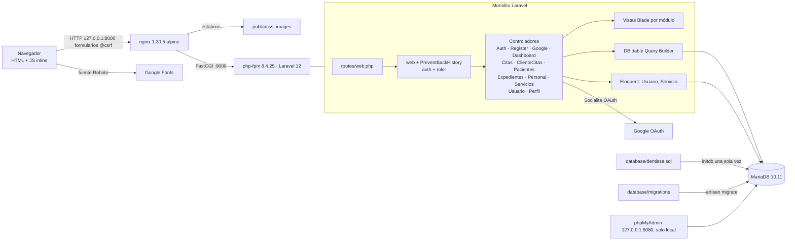
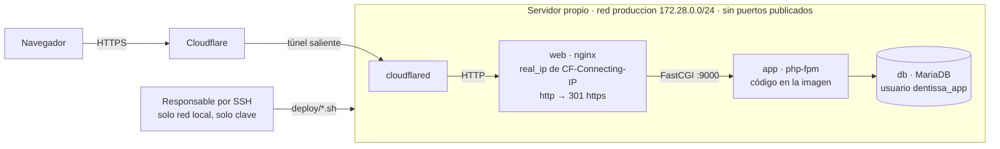

# Arquitectura de Dentissa

## Resumen
Monolito Laravel 12 con MVC clásico que renderiza HTML en el servidor con Blade (aplicación
multipágina, sin API ni SPA). Casi toda la lógica de negocio y el acceso a datos viven dentro de
13 controladores. Las piezas de servicio están en `app/Agenda/`: `ReservaCitas.php` (spec 025), con la
regla de agenda, `EstadosCita.php` (spec 026), con los estados de la cita, `HorarioDentista.php`
(spec 027), con el horario del dentista, y `ReprogramacionCitas.php` (spec 028), con la reprogramación. Los Gates de citas y de personal viven en
`app/Autorizacion/` (specs 026, 027 y 028), y la regla de validación `HoraFinPosterior`, en `app/Rules/`; no hay repositorios, Policies, Form Requests, eventos ni jobs.
El acceso a datos es casi siempre Query Builder (`DB::table` con joins manuales); solo `usuarios`
y `servicios` tienen modelo Eloquent. La autorización combina un middleware propio `role:` con
comprobaciones en cada controlador y, para los cambios de estado y la reprogramación de las citas,
los Gates `gestionar-cita`, `cambiar-estado-cita` y `reprogramar-cita`. El esquema del dominio no está en migraciones: vive
en el volcado `database/dentissa.sql`, que Docker carga al inicializar la base.

## Diagrama de componentes

El diagrama es el entorno local. En producción (spec 030) la entrada es el túnel de Cloudflare
y no existe phpMyAdmin; ver [Despliegue](#despliegue).

## Módulos
| Módulo | Ruta | Responsabilidad | Depende de |
|---|---|---|---|
| Autenticación | `app/Http/Controllers/AuthController.php`, `GoogleAuthController.php` | Login con correo, logout, OAuth con Google. Límite de intentos (spec 030): el login cuenta fallos por correo e IP (5 por minuto, `RateLimiter` en el controlador) y la vuelta de Google pasa por el limitador `google`; los dos rechazos emiten `Lockout` | `usuarios`, Socialite, caché (limitadores) |
| Registro | `app/Http/Controllers/RegisterController.php` | Autorregistro de pacientes en dos pasos y asignación automática de dentista; `POST /registro` y `/registro/contacto` pasan por el limitador `registro` (5 por minuto por IP, spec 030) | `usuarios`, `pacientes`, `personal`, caché (limitadores) |
| Paneles | `app/Http/Controllers/DashboardController.php` | Un panel por rol; el del paciente ofrece «Reprogramar» y «Cancelar» de la próxima cita solo con 24 horas o más, con `app/Agenda/EstadosCita.php` (spec 028) | `citas`, `pacientes`, `asistente_dentista` |
| Agenda (personal) | `app/Http/Controllers/CitasController.php` | Listado, alta, detalle, estado, notas, reprogramación y cancelación de citas con alcance por rol (vía `app/Autorizacion/AlcanceClinico.php`); el alta delega la regla de agenda en `app/Agenda/ReservaCitas.php`, el cambio de estado y "eliminar" en `app/Agenda/EstadosCita.php`, y la reprogramación en `app/Agenda/ReprogramacionCitas.php` (spec 028) | `citas`, `horarios_dentista`, `historial_citas`, `servicios`, `expedientes` |
| Agenda (cliente) | `app/Http/Controllers/ClienteCitasController.php` | Mis citas, agendar, reprogramar y cancelar con 24 horas o más de antelación; agendar delega la regla de agenda en `app/Agenda/ReservaCitas.php`, cancelar en `app/Agenda/EstadosCita.php` y reprogramar en `app/Agenda/ReprogramacionCitas.php` (spec 028) | `citas`, `horarios_dentista`, `servicios`, `historial_citas` |
| Agenda (regla) | `app/Agenda/ReservaCitas.php`, `app/Agenda/CitaNoAgendable.php` | Regla de agenda única (horario del día, encaje en la franja, solape estricto) y guardado de la cita en una transacción que bloquea primero la fila del dentista (spec 025); `bloquearDentista` y `comprobarHueco` (con la cita que se excluye al reprogramar) son públicos para la reprogramación (spec 028) | `personal` (bloqueo), `horarios_dentista`, `citas` |
| Agenda (estados) | `app/Agenda/EstadosCita.php`, `app/Agenda/CambioDeEstadoNoPermitido.php` | Transiciones de estado, estados cerrados, regla "ya empezó" en la zona de la clínica (`config/clinica.php`) y guardado del cambio con una sola entrada de historial con autor, en una transacción que bloquea primero la fila de la cita (spec 026) | `citas` (bloqueo), `historial_citas` |
| Agenda (reprogramación) | `app/Agenda/ReprogramacionCitas.php` | Mueve una cita a otra fecha y hora sin cambiar dentista, servicio ni duración: en una transacción bloquea el dentista y la cita, comprueba con `EstadosCita::comprobarReprogramable` que no esté cerrada ni empezada (y el plazo de 24 h del paciente), exige como al agendar un dentista activo y una duración válida, rechaza fechas pasadas o iguales (al minuto), aplica la regla de `ReservaCitas::comprobarHueco` sin contar la propia cita, devuelve una confirmada a agendada y escribe una sola entrada de historial con las dos fechas (spec 028) | `personal` (bloqueo), `citas` (bloqueo), `horarios_dentista`, `historial_citas` |
| Agenda (horario) | `app/Agenda/HorarioDentista.php`, `app/Agenda/HorarioNoGuardado.php`, `app/Rules/HoraFinPosterior.php` | Guardado del horario semanal del dentista en una transacción que bloquea primero su fila de `personal` (el mismo bloqueo que la reserva), cálculo de las citas futuras agendadas o confirmadas que quedan fuera (misma regla de franja que `ReservaCitas`) y validación de que la hora de fin sea posterior a la de inicio sin error 500 con entradas manipuladas (spec 027) | `personal` (bloqueo), `horarios_dentista`, `citas`, `pacientes`, `usuarios` |
| Autorización de citas | `app/Autorizacion/AlcanceClinico.php`, `app/Autorizacion/CambiarEstadoCita.php`, `app/Autorizacion/ReprogramarCita.php` | Alcance del personal sobre las citas (ADR 0003) y Gates `gestionar-cita` y `cambiar-estado-cita` (spec 026) y `reprogramar-cita` (spec 028: administración, asistente y paciente, nunca el dentista), registrados en `AppServiceProvider` | `personal`, `asistente_dentista`, `pacientes` |
| Autorización de personal | `app/Autorizacion/GestionPersonal.php` | Gate `definir-horario`, registrado en `AppServiceProvider`: solo la administración, y solo sobre un dentista (otro tipo de personal → 404) (spec 027) | `personal` |
| Pacientes | `app/Http/Controllers/PacientesController.php` | CRUD de pacientes y alta de su usuario | `usuarios`, `pacientes`, `expedientes`, `citas` |
| Expedientes | `app/Http/Controllers/ExpedientesController.php` | Expediente clínico ligado a una cita | `expedientes`, `citas` |
| Personal | `app/Http/Controllers/PersonalController.php` | CRUD de personal, asignación asistente↔dentista y horarios: valida el horario y lo guarda con `app/Agenda/HorarioDentista.php`, que también da la lista de citas fuera del horario de la ficha (spec 027) | `personal`, `usuarios`, `horarios_dentista`, `asistente_dentista` |
| Servicios | `app/Http/Controllers/ServiciosController.php` | Catálogo (Eloquent + `Route::resource`) | `servicios` |
| Usuarios | `app/Http/Controllers/UsuarioController.php` | Administración de cuentas y roles | `usuarios` |
| Perfil | `app/Http/Controllers/PerfilController.php` | Perfil y contraseña del cliente | `usuarios`, `pacientes` |
| Middleware | `app/Http/Middleware/RoleMiddleware.php`, `PreventBackHistory.php` | Rol por grupo de rutas; cabeceras no-cache | `usuarios.rol` |
| Límites de intentos | `app/Providers/AppServiceProvider.php` (limitadores `registro` y `google`), `AuthController::login`, `routes/web.php` (`throttle:`) | 5 intentos por minuto; mismo mensaje en los tres casos, que no revela si la cuenta existe (spec 030, CA8) | caché (`CACHE_STORE=database` en producción) |
| Proxy | `bootstrap/app.php` (`trustProxies`) | Detrás de nginx y el túnel, Laravel solo confía en `X-Forwarded-Proto` (URL y redirecciones en https); la IP real la pone nginx en `REMOTE_ADDR` (spec 030, D3) | — |
| Comandos | `app/Console/Commands/RotarCredencialesVolcado.php` | `dentissa:rotar-credenciales --confirmar`: contraseña aleatoria para cada cuenta del volcado con contraseña, mostrada una sola vez (spec 030, CA5) | `usuarios` |

Los controladores no se llaman entre sí; se acoplan a través del esquema compartido. Los mismos
controladores sirven a varios roles bajo prefijos `/admin`, `/dentista`, `/asistente`; `/cliente`
tiene su propio grupo.

## Flujo principal
Ejemplo: el personal agenda una cita.
1. El navegador envía `POST /admin/citas` con `@csrf` a nginx (puerto 8000).
2. nginx lo pasa por FastCGI a php-fpm (`app:9000`).
3. Laravel aplica el grupo `web` (incluye `PreventBackHistory`), luego `auth` y `role:admin`.
4. `CitasController@store` valida la entrada (fecha, hora y dentista activo, con las reglas
   comunes de `ReservaCitas`), comprueba el alcance por rol y llama a `ReservaCitas::reservar`. En
   una transacción, el servicio bloquea la fila del dentista, revisa `horarios_dentista` y los
   solapes, e inserta la cita. Un rechazo vuelve al formulario como error del campo hora.
5. Responde `redirect()` con flash `success`, que muestra `layouts/app.blade.php`.
Al cambiar el estado de una cita, `EstadosCita` escribe una sola fila en `historial_citas`, con
autor, estado anterior y nuevo, y motivo, en la misma transacción que el cambio (spec 026). Al
reprogramarla, `ReprogramacionCitas` escribe también una sola fila, con la fecha y hora anterior y la
nueva en `fecha_hora_anterior` y `fecha_hora_nueva` (spec 028).

## Datos
- Motor: MariaDB 10.11 en Docker (el volcado se generó con 10.4.32). PKs UUID `char(36)`.
  Columnas `creado_en`/`actualizado_en` escritas a mano (sin timestamps de Laravel).
- Acceso: PDO con Query Builder (≈157 usos de `DB::` en controladores) y Eloquent solo para
  `Usuario` (modelo de autenticación, tabla `usuarios`) y `Servicio`.
- Entidades: `usuarios` (rol enum cliente/asistente/dentista/admin), `pacientes`, `personal`
  (tipo dentista/asistente/administrador), `asistente_dentista`, `horarios_dentista`, `servicios`,
  `citas` (estado enum de 6 valores), `historial_citas`, `expedientes`. Vistas SQL `v_citas_hoy` y
  `v_historial_paciente` (no las usa el código PHP).
- Esquema: las tablas de dominio, las vistas y el trigger `trg_historial_cita` solo existen en
  `database/dentissa.sql`. Las migraciones crean tablas de infraestructura (`users`, `sessions`,
  `cache`, `jobs`…) y `asistente_dentista`, alteran `usuarios` y `pacientes`, que ninguna migración
  crea, retiran el trigger (spec 026) y añaden a `historial_citas` `fecha_hora_anterior` y
  `fecha_hora_nueva` (`DATETIME NULL`, spec 028). El
  esquema no se puede recrear desde migraciones sobre una base vacía.

## Integraciones externas
- Google OAuth mediante `laravel/socialite` (`/auth/google`, `/auth/google/callback`); variables
  `GOOGLE_CLIENT_ID`, `GOOGLE_CLIENT_SECRET`, `GOOGLE_REDIRECT_URI`.
- Google Fonts (Roboto) desde el navegador.
- No hay correo, colas, almacenamiento de archivos ni APIs HTTP salientes en uso.

## Frontend
- Componentes y organización: vistas Blade por módulo en `resources/views/<modulo>/`, archivos en
  kebab-case, un único layout `layouts/app.blade.php`, parciales en `partials/`. Sin componentes
  `<x-…>`. `edit` reutiliza `create` con `@include`.
- Estado: sin estado de cliente; JS inline mínimo (`@push('scripts')`) para modales y rellenar
  campos.
- Routing: rutas con nombre en `routes/web.php`; hay 50 `href="/..."` escritos a mano en vistas.
- Design tokens / sistema de diseño: CSS propio en `public/css/app.css`, `auth.css`, `citas.css`
  con variables (`--p50…--p800`, `--text`, `--border`), mucho `style=""` inline. Vite + Tailwind 4
  están declarados pero solo los usa `welcome.blade.php`, que ninguna ruta sirve.
- Accesibilidad: WCAG 2.1 AA (decisión del usuario, 2026-10-02); principio P9 y deuda DS1–DS11 en [design/system.md](design/system.md).

## Backend
- Contratos de API: no hay API; el contrato es formulario HTML ↔ `$request->validate()`.
- Autenticación y autorización: sesión de Laravel (guard `web`) sobre `App\Models\Usuario`;
  middleware `role:` por grupo de rutas; comprobaciones de fila en controladores
  (`aplicarAlcanceRol`, `autorizadoParaCita`, que delegan en `AlcanceClinico`), y Gates para los
  cambios de estado (spec 026) y la reprogramación (spec 028) de las citas. Detalle en [security.md](security.md).
- Observabilidad: sin logs propios, sin correlación, sin auditoría; ver [observability.md](observability.md).
- Seguridad: CSRF por defecto, consultas con bindings, sin `{!! !!}`; riesgos en [security.md](security.md).

## Contrato entre capas
- Fuente de verdad: nombres de campo de los formularios Blade frente a las reglas de validación de
  cada controlador. No hay tipos ni esquemas compartidos.
- Versionado: no aplica (sin API pública).
- Cómo se regenera: no aplica.

## Despliegue
Dos entornos (spec 030, [ADR 0005](adr/0005-produccion-servidor-propio-cloudflare-tunnel.md)):
- **Local:** Docker Compose (`app` php-fpm, `nginx`, `db` MariaDB, `phpmyadmin`), con los puertos
  solo en `127.0.0.1` y las imágenes con versión exacta.
- **Producción:** servidor propio (Ubuntu Server 24.04) con `docker-compose.prod.yml`. Staging no
  existe.

- `docker/prod/Dockerfile`: imágenes multietapa `app` (sin dependencias de desarrollo, secretos ni
  volcado; paquetes del sistema actualizados al construir) y `web` (nginx con `public/` y
  `docker/nginx/dentissa.prod.conf`).
- `deploy/`: scripts que el responsable ejecuta por SSH (preparar el servidor, desplegar, copia,
  restauración, vuelta atrás y verificación) y la guía `deploy/README.md`.
- Secretos en `app.env`, `db.env` y `tunnel.env` fuera del clon; volúmenes `db_data`, `storage` y
  `nginx_logs`.

Detalle en [deployment.md](deployment.md).

## Evidencia (solo si status=inferred)
| Afirmación | Archivos | Confianza |
|---|---|---|
| MVC sin capa de dominio | `app/Http/Controllers/*`, `app/Providers/AppServiceProvider.php` | alta |
| Solo 2 modelos de dominio | `app/Models/Usuario.php`, `app/Models/Servicio.php` | alta |
| Autorización por rol + checks inline | `bootstrap/app.php`, `app/Http/Middleware/RoleMiddleware.php`, `CitasController.php` | alta |
| Esquema solo en volcado | `database/dentissa.sql`, `database/migrations/*`, `database/testing/bootstrap-test-db.sh` | alta |
| Vite/Tailwind sin uso real | `vite.config.js`, `resources/views/welcome.blade.php`, `layouts/app.blade.php` | alta |
| Integración Google OAuth | `GoogleAuthController.php`, `config/services.php` | alta |
| Entornos local y producción | `docker-compose.yml`, `Dockerfile`, `docker-compose.prod.yml`, `docker/prod/Dockerfile`, `docker/nginx/dentissa.prod.conf`, `deploy/` | alta |

## Deuda técnica y riesgos observados
- Esquema del dominio no reproducible desde migraciones; el volcado está desfasado respecto a las
  3 migraciones de julio (→ roadmap objetivo 1, spec 013).
- Ayudante de dentistas disponibles copiado en 2 sitios y consulta base de citas en 4.
- Restos del esqueleto: `App\Models\User`, tabla `users`, `DatabaseSeeder`, `welcome.blade.php`,
  nombre `laravel/laravel` en `composer.json`, README genérico.
- `Route::resource('servicios')` registra `show`, que el controlador no implementa.
- Convenciones inconsistentes de rutas (`/crear` vs `/create`, `/edit` vs `/editar`, nombres con y
  sin `.index`).
- ~~`docker-compose.yml` monta `./docker/php/local.ini`, pero el archivo está en `docker/nginx/php/local.ini`.~~
  Corregido en la spec 030 (RD4.a).
