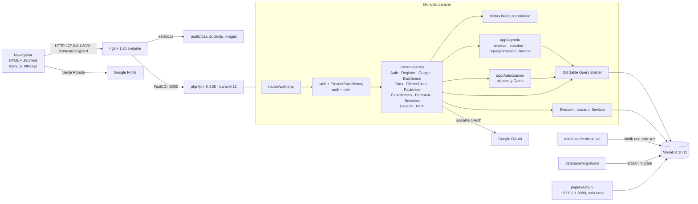
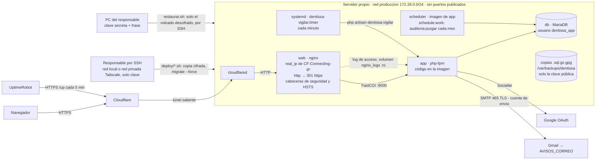

# Arquitectura de Dentissa

## Resumen
Monolito Laravel 12 con MVC clásico que renderiza HTML en el servidor con Blade (aplicación
multipágina, sin API ni SPA). Casi toda la lógica de negocio y el acceso a datos viven dentro de
12 controladores (más el `Controller` base). Las piezas de servicio están en `app/Agenda/`: `ReservaCitas.php` (spec 025), con la
regla de agenda, `EstadosCita.php` (spec 026), con los estados de la cita, `HorarioDentista.php`
(spec 027), con el horario del dentista, y `ReprogramacionCitas.php` (spec 028), con la reprogramación. Los Gates de citas y de personal viven en
`app/Autorizacion/` (specs 026, 027 y 028), y la regla de validación `HoraFinPosterior`, en `app/Rules/`; no hay repositorios, Policies, Form Requests, eventos ni jobs.
El acceso a datos es casi siempre Query Builder (`DB::table` con joins manuales); solo `usuarios`
y `servicios` tienen modelo Eloquent. La autorización combina un middleware propio `role:` con
comprobaciones en cada controlador y, para los cambios de estado y la reprogramación de las citas,
los Gates `gestionar-cita`, `cambiar-estado-cita` y `reprogramar-cita`, y el horario del dentista, el Gate
`definir-horario`. El esquema del dominio no está en migraciones: vive
en el volcado `database/dentissa.sql`, que Docker carga al inicializar la base.

## Diagrama de componentes

El diagrama es el entorno local. En producción (spec 030) la entrada es el túnel de Cloudflare
y no existe phpMyAdmin; ver [Despliegue](#despliegue).

## Módulos
| Módulo | Ruta | Responsabilidad | Depende de |
|---|---|---|---|
| Autenticación | `app/Http/Controllers/AuthController.php`, `GoogleAuthController.php` | Login con correo, logout, OAuth con Google. Límite de intentos (spec 030): el login cuenta fallos por correo e IP (5 por minuto, `RateLimiter` en el controlador) y la vuelta de Google pasa por el limitador `google`; los dos rechazos emiten `Lockout` | `usuarios`, Socialite, caché (limitadores) |
| Registro | `app/Http/Controllers/RegisterController.php` | Autorregistro de pacientes en dos pasos y asignación automática de dentista; `POST /registro` y `/registro/contacto` pasan por el limitador `registro` (5 por minuto por IP, spec 030) | `usuarios`, `pacientes`, `personal`, caché (limitadores) |
| Paneles | `app/Http/Controllers/DashboardController.php` | Un panel por rol; el del paciente ofrece «Reprogramar» y «Cancelar» de la próxima cita solo con 24 horas o más, con `app/Agenda/EstadosCita.php` (spec 028) | `citas`, `pacientes`, `personal`, `usuarios`, `servicios`, `asistente_dentista`, el aviso de plazo de `ClienteCitasController` |
| Agenda (personal) | `app/Http/Controllers/CitasController.php` | Listado, alta, detalle, estado, notas, reprogramación y cancelación de citas con alcance por rol (vía `app/Autorizacion/AlcanceClinico.php`); el alta delega la regla de agenda en `app/Agenda/ReservaCitas.php`, el cambio de estado y "eliminar" en `app/Agenda/EstadosCita.php`, y la reprogramación en `app/Agenda/ReprogramacionCitas.php` (spec 028) | `citas`, `horarios_dentista`, `historial_citas`, `servicios`, `expedientes` |
| Agenda (cliente) | `app/Http/Controllers/ClienteCitasController.php` | Mis citas, agendar, reprogramar y cancelar con 24 horas o más de antelación; agendar delega la regla de agenda en `app/Agenda/ReservaCitas.php`, cancelar en `app/Agenda/EstadosCita.php` y reprogramar en `app/Agenda/ReprogramacionCitas.php` (spec 028) | `citas`, `horarios_dentista`, `servicios`, `historial_citas` |
| Agenda (regla) | `app/Agenda/ReservaCitas.php`, `app/Agenda/CitaNoAgendable.php` | Regla de agenda única (horario del día, encaje en la franja, solape estricto) y guardado de la cita en una transacción que bloquea primero la fila del dentista (spec 025); `bloquearDentista` y `comprobarHueco` (con la cita que se excluye al reprogramar) son públicos para la reprogramación (spec 028) | `personal` (bloqueo), `horarios_dentista`, `citas` |
| Agenda (estados) | `app/Agenda/EstadosCita.php`, `app/Agenda/CambioDeEstadoNoPermitido.php` | Transiciones de estado, estados cerrados, regla "ya empezó" en la zona de la clínica (`config/clinica.php`) y guardado del cambio con una sola entrada de historial con autor, en una transacción que bloquea primero la fila de la cita (spec 026) | `citas` (bloqueo), `historial_citas` |
| Agenda (reprogramación) | `app/Agenda/ReprogramacionCitas.php` | Mueve una cita a otra fecha y hora sin cambiar dentista, servicio ni duración: en una transacción bloquea el dentista y la cita, comprueba con `EstadosCita::comprobarReprogramable` que no esté cerrada ni empezada, que tenga, como al agendar, un dentista activo y una duración válida (y el plazo de 24 h del paciente), comprobación que usan también el detalle y el panel del paciente para ofrecer «Reprogramar», rechaza fechas pasadas o iguales (al minuto), aplica la regla de `ReservaCitas::comprobarHueco` sin contar la propia cita, devuelve una confirmada a agendada y escribe una sola entrada de historial con las dos fechas (spec 028) | `personal` (bloqueo), `citas` (bloqueo), `horarios_dentista`, `historial_citas` |
| Agenda (horario) | `app/Agenda/HorarioDentista.php`, `app/Agenda/HorarioNoGuardado.php`, `app/Rules/HoraFinPosterior.php` | Guardado del horario semanal del dentista en una transacción que bloquea primero su fila de `personal` (el mismo bloqueo que la reserva), cálculo de las citas futuras agendadas o confirmadas que quedan fuera (misma regla de franja que `ReservaCitas`) y validación de que la hora de fin sea posterior a la de inicio sin error 500 con entradas manipuladas (spec 027) | `personal` (bloqueo), `horarios_dentista`, `citas`, `pacientes`, `usuarios` |
| Autorización de citas | `app/Autorizacion/AlcanceClinico.php`, `app/Autorizacion/CambiarEstadoCita.php`, `app/Autorizacion/ReprogramarCita.php` | Alcance del personal sobre las citas (ADR 0003) y Gates `gestionar-cita` y `cambiar-estado-cita` (spec 026) y `reprogramar-cita` (spec 028: administración, asistente y paciente, nunca el dentista), registrados en `AppServiceProvider` | `personal`, `asistente_dentista`, `pacientes` |
| Autorización de personal | `app/Autorizacion/GestionPersonal.php` | Gate `definir-horario`, registrado en `AppServiceProvider`: solo la administración, y solo sobre un dentista (otro tipo de personal → 404) (spec 027) | `personal` |
| Pacientes | `app/Http/Controllers/PacientesController.php` | CRUD de pacientes y alta de su usuario | `usuarios`, `pacientes`, `expedientes`, `citas` |
| Expedientes | `app/Http/Controllers/ExpedientesController.php` | Expediente clínico ligado a una cita | `expedientes`, `citas` |
| Personal | `app/Http/Controllers/PersonalController.php` | CRUD de personal, asignación asistente↔dentista y horarios: valida el horario y lo guarda con `app/Agenda/HorarioDentista.php`, que también da la lista de citas fuera del horario de la ficha (spec 027) | `personal`, `usuarios`, `horarios_dentista`, `asistente_dentista` |
| Servicios | `app/Http/Controllers/ServiciosController.php` | Catálogo (Eloquent + `Route::resource`) | `servicios` |
| Usuarios | `app/Http/Controllers/UsuarioController.php` | Administración de cuentas y roles | `usuarios` |
| Perfil | `app/Http/Controllers/PerfilController.php` | Perfil y contraseña del cliente | `usuarios`, `pacientes` |
| Middleware | `app/Http/Middleware/RoleMiddleware.php`, `PreventBackHistory.php`, `IdentificadorPeticion.php`, `ContextoActor.php` | Rol por grupo de rutas; cabeceras no-cache. Spec 020: `IdentificadorPeticion` (global) reutiliza el `X-Request-Id` si es un UUID o genera uno, lo pone en el `Context` y lo devuelve en toda respuesta; `ContextoActor` (al final del grupo `web`) pone o quita el actor de los logs al empezar cada petición | `usuarios.rol`, `Context` de Laravel |
| Auditoría | `app/Auditoria/` (`Auditoria`, `AlmacenAuditoria` y `AlmacenAuditoriaBaseDatos`, `RegistroCentralDenegaciones`, `AuditoriaNoDisponible`, `AccesoDenegadoAuditado`), `app/Listeners/ActualizarActorDelContexto.php`, `AuditoriaController`, `routes/console.php` (`auditoria:purgar`) | Registro de auditoría común (spec 020, [ADR 0004](adr/0004-registro-auditoria-mariadb.md)): `Auditoria::registrar()` y `denegar()` son el único punto de registro; actor de la sesión o de un `Usuario` comprobado, IP y `request_id` de la petición, solo identificadores y nombres de campo; modo crítico con fallo cerrado (página 503 genérica). Las denegaciones las registra el callback `respond` de `withExceptions` (403 y 404 de Gates con `denyAsNotFound`). Un fallo al escribir deja `auditoria.fallo` en el canal `seguridad`. Consulta en `/admin/auditoria`, solo para el admin y solo lectura; purga mensual de lo de más de 5 años en el servicio `scheduler` | tabla `auditoria`, canal `seguridad`, `Context` |
| Límites de intentos | `app/Providers/AppServiceProvider.php` (limitadores `registro` y `google`), `AuthController::login`, `routes/web.php` (`throttle:`) | 5 intentos por minuto; mismo mensaje en los tres casos, que no revela si la cuenta existe (spec 030, CA8) | caché (`CACHE_STORE=database` en producción) |
| Proxy | `bootstrap/app.php` (`trustProxies`) | Detrás de nginx y el túnel, Laravel solo confía en `X-Forwarded-Proto` (URL y redirecciones en https); la IP real la pone nginx en `REMOTE_ADDR` (spec 030, D3) | — |
| Comandos | `app/Console/Commands/RotarCredencialesVolcado.php`, `app/Console/Commands/Vigilar.php` | `dentissa:rotar-credenciales --confirmar`: contraseña aleatoria para cada cuenta del volcado con contraseña, mostrada una sola vez (spec 030, CA5). `dentissa:vigilar` (y `--prueba`): una vuelta del vigilante de avisos; sale con código distinto de 0 si un aviso no se pudo enviar (spec 032) | `usuarios`; `app/Avisos`, correo |
| Registro de fallos de acceso | `app/Listeners/RegistrarFalloAcceso.php`, canal `seguridad` de `config/logging.php` | Escucha `Failed` y `Lockout` (descubierto automáticamente) y escribe una línea JSON por intento fallido o bloqueado, con huellas HMAC del origen y de la cuenta (`AuthController::origenLimite` y `sujetoLimite`, las mismas reglas que el limitador), sin IP ni correo. Alerta, no audita (spec 032, ADR 0007) | `AuthController`, `usuarios` |
| Avisos de producción | `app/Avisos/Vigilante.php`, `app/Avisos/Estado.php`, `app/Mail/AvisoProduccion.php`, `config/avisos.php` | Lee lo nuevo del log de acceso de nginx y del canal `seguridad` (desplazamientos e inodo en `storage/app/avisos/estado.json`, con tope por ejecución), cuenta en una ventana de 5 minutos y avisa por correo de errores del servidor (> 1 %), inicios de sesión fallidos (> 10 por origen o cuenta), log con otro formato y, desde la spec 020, eventos de auditoría que no se pudieron guardar (uno basta; las líneas del canal se distinguen por su mensaje); un correo por tipo cada 30 minutos con el acumulado, sin datos de los logs (spec 032, ADR 0007) | log de acceso (volumen `nginx_logs`), canal `seguridad`, Mail de Laravel |

Los controladores no se llaman entre sí, salvo dos excepciones: `DashboardController` usa el aviso de
plazo de `ClienteCitasController` y `AppServiceProvider` usa `AuthController::origenLimite` y su
mensaje de demasiados intentos. Fuera de los controladores, `RegistrarFalloAcceso` usa
`AuthController::origenLimite` y `sujetoLimite` (spec 032). El resto se acopla a través del esquema compartido. Los mismos
controladores sirven a varios roles bajo prefijos `/admin`, `/dentista`, `/asistente`; `/cliente`
tiene su propio grupo, que solo exige `auth` (`role:cliente` va ruta a ruta en cancelar y
reprogramar; RS2.a). Otras rutas: `/` redirige según el rol, `/admin/reportes` sirve
`placeholder.blade.php`, `/admin/auditoria` es la consulta del registro de auditoría (spec 020), `/_disenio/020/{pantalla}` es una vista previa del diseño que solo existe con `APP_ENV=local`, y `/up` es la ruta de salud que comprueba `deploy/verificar.sh`.

## Flujo principal
Ejemplo: el personal agenda una cita.
1. El navegador envía `POST /admin/citas` con `@csrf` a nginx (puerto 8000).
2. nginx lo pasa por FastCGI a php-fpm (`app:9000`).
3. Laravel aplica el grupo `web` (incluye `PreventBackHistory`), luego `auth` y `role:admin`.
4. `CitasController@store` valida la entrada (fecha, hora y dentista activo, con las reglas
   comunes de `ReservaCitas`), comprueba el alcance por rol y llama a `ReservaCitas::reservar`. En
   una transacción, el servicio bloquea la fila del dentista, revisa `horarios_dentista` y los
   solapes, e inserta la cita. Un rechazo vuelve al formulario como error del campo hora.
5. Responde `redirect()` con flash `success`, que muestra `layouts/app.blade.php`.
Al cambiar el estado de una cita, `EstadosCita` escribe una sola fila en `historial_citas`, con
autor, estado anterior y nuevo, y motivo, en la misma transacción que el cambio (spec 026). Al
reprogramarla, `ReprogramacionCitas` escribe también una sola fila, con la fecha y hora anterior y la
nueva en `fecha_hora_anterior` y `fecha_hora_nueva` (spec 028).

## Datos
- Motor: MariaDB 10.11 en Docker (el volcado se generó con 10.4.32). PKs UUID `char(36)`.
  Columnas `creado_en`/`actualizado_en` escritas a mano (sin timestamps de Laravel).
- Acceso: PDO con Query Builder (148 usos de `DB::` en controladores y 4 más en `app/Autorizacion`
  y el comando; `app/Agenda` recibe la conexión inyectada) y Eloquent solo para
  `Usuario` (modelo de autenticación, tabla `usuarios`) y `Servicio`.
- Entidades: `usuarios` (rol enum cliente/asistente/dentista/admin), `pacientes`, `personal`
  (tipo dentista/asistente/administrador), `asistente_dentista`, `horarios_dentista`, `servicios`,
  `citas` (estado enum de 6 valores), `historial_citas` (`cambiado_por`, `estado_anterior`,
  `estado_nuevo`, `motivo`, `fecha_hora_anterior`, `fecha_hora_nueva`), `expedientes` y, desde la
  spec 020, `auditoria` (`id` autoincremental, `ocurrido_en` en UTC con microsegundos, actor sin
  clave foránea, acción, recurso, resultado de vocabulario cerrado, `campos` y `detalle` JSON, IP y
  `request_id`; índices por fecha, acción, recurso y petición). Vistas SQL `v_citas_hoy` y
  `v_historial_paciente` (no las usa el código PHP).
- Esquema: las tablas de dominio, las vistas y el trigger `trg_historial_cita` solo existen en
  `database/dentissa.sql`. Las migraciones crean tablas de infraestructura (`users`, `sessions`,
  `cache`, `jobs`…) y `asistente_dentista`, alteran `usuarios` y `pacientes`, que ninguna migración
  crea, retiran el trigger (spec 026) y añaden a `historial_citas` `fecha_hora_anterior` y
  `fecha_hora_nueva` (`DATETIME NULL`, spec 028). La tabla `auditoria` sí nace de una migración
  (spec 020), con sus triggers `auditoria_sin_update` (rechaza todo `UPDATE`) y
  `auditoria_sin_delete` (solo deja borrar con el indicador `@auditoria_purga` y eventos de más de
  5 años medidos con `UTC_TIMESTAMP()`). El
  esquema no se puede recrear desde migraciones sobre una base vacía.

## Integraciones externas
- Google OAuth mediante `laravel/socialite` (`/auth/google`, `/auth/google/callback`); variables
  `GOOGLE_CLIENT_ID`, `GOOGLE_CLIENT_SECRET`, `GOOGLE_REDIRECT_URI`.
- Google Fonts (Roboto) desde el navegador.
- Correo saliente (spec 032): avisos de producción por el SMTP de Gmail (`smtp.gmail.com:465`, TLS
  implícito) con una cuenta que solo sirve para enviar, hacia `AVISOS_CORREO`; variables `MAIL_*` y
  `AVISOS_CORREO` en `app.env`. Local usa `MAIL_MAILER=log`.
- UptimeRobot (spec 032, plan gratuito): comprueba `https://<dominio>/up` cada 5 minutos desde fuera
  y avisa por correo al caer y al volver, también con el servidor apagado. No recibe datos.
- No hay colas, almacenamiento de archivos ni APIs HTTP salientes en uso.

## Frontend
- Componentes y organización: vistas Blade por módulo en `resources/views/<modulo>/`, archivos en
  kebab-case, un único layout `layouts/app.blade.php` (las vistas de acceso tienen su propio HTML
  con `auth.css`), parciales en `partials/` y en `<modulo>/partials/`. Sin componentes `<x-…>`. En
  pacientes, personal y usuarios, `edit` reutiliza `create` con `@include`; servicios tiene su
  propio formulario de edición.
- Estado: sin estado de cliente; JS inline mínimo (`@push('scripts')`) para modales y rellenar
  campos. `public/js/menu.js` (spec 033) es el primer script propio en un archivo: lo carga el
  layout en `<head>` sin `defer`, marca `<html>` con `menu-js` y abre y cierra el menú del móvil
  (`aria-expanded`, `inert` en `<main>`, foco y Escape); sin JS, el menú queda en el flujo.
  `public/js/filtros.js` (spec 034), el segundo, lo carga solo la lista de citas del personal en
  `<head>` sin `defer`: marca `<html>` con `filtros-js` y pliega y despliega el panel de filtros
  con el botón «Filtros» (`aria-expanded`); sin JS, el filtro queda desplegado. La consulta de
  auditoría (spec 020) también lo carga.
- Pantallas de la spec 020: `auditoria/index.blade.php` (consulta con filtro plegable, lista
  `tabla-auditoria` que en el móvil se lee como tarjetas, estado vacío, error junto al campo y la
  paginación `nav.paginacion` del sistema 1.7.0) y `errors/auditoria-no-disponible.blade.php`, la
  página 503 del modo crítico: documento propio sin el layout autenticado, `noindex`, con
  `app.css`, `errores.css` y la Roboto propia de `public/fonts/roboto/` (sin Google Fonts).
- Routing: rutas con nombre en `routes/web.php`; hay 49 `href="/..."` escritos a mano en vistas.
- Design tokens / sistema de diseño: CSS propio en `public/css/app.css`, `auth.css`, `citas.css`
  con variables (`--p50…--p800`, `--text`, `--border`), mucho `style=""` inline. `public/css/movil.css`
  (spec 033), cargada por el layout tras `app.css`, adapta la app por debajo de 900 px: la barra
  lateral pasa a menú desplegable, el contenido ocupa todo el ancho y los controles miden 44 px;
  en el escritorio no cambia nada. Desde la spec 034, en el móvil las tablas con `tabla-tarjetas`
  (listas de citas, pacientes y servicios, y las de los paneles) se leen como tarjetas, una por fila,
  con la etiqueta de cada celda en su `data-label` y las columnas `solo-escritorio` ocultas; y el
  logo de la barra se pinta con una máscara (`mask` con `--p600`), porque la imagen con
  `mix-blend-mode: screen` desaparece sobre blanco. Desde la spec 035, en el móvil la ficha del
  paciente (`.ficha-paciente`) y la del expediente (`.ficha-expediente`) van en una columna en el
  orden del HTML; el perfil del paciente es compacto (iniciales y datos en una fila, cada dato con su
  etiqueta); las acciones de la barra de la ficha (`.acciones-ficha`) bajan a una fila bajo el título
  con `.topbar-actions:has(.acciones-ficha)` (sin `:has()`, quedan a la derecha como antes, sin
  desbordar), y los formularios de paciente y expediente llevan etiquetas con `for`/`id`, errores
  con `aria-describedby` y la fila `.acciones-formulario`. Los iconos «Menú» y «Cerrar menú» van sin
  recuadro. Vite + Tailwind 4 están declarados pero solo los usa `welcome.blade.php`, que ninguna ruta sirve.
- SEO (upgrade a AI-DD 1.13.0): todo el HTML se renderiza en el servidor con Blade, sin depender de
  JavaScript. Las vistas de acceso (`resources/views/auth/*.blade.php`) tienen su propio `<head>`,
  donde van los metadatos de la única ruta indexable, `/registro`; el resto usa el `<head>` de
  `layouts/app.blade.php`. `public/robots.txt` es estático y no hay `sitemap.xml`. Reglas y brechas
  en [seo.md](seo.md).
- Accesibilidad: WCAG 2.1 AA (decisión del usuario, 2026-10-02); principio P9 y deuda DS1–DS11 en [design/system.md](design/system.md).

## Backend
- Contratos de API: no hay API; el contrato es formulario HTML ↔ `$request->validate()`.
- Autenticación y autorización: sesión de Laravel (guard `web`) sobre `App\Models\Usuario`;
  middleware `role:` por grupo de rutas (el de `/cliente`, solo `auth`); comprobaciones de fila en
  controladores (`aplicarAlcanceRol`, `autorizadoParaCita`, que delegan en `AlcanceClinico`), y
  Gates para los cambios de estado (spec 026) y la reprogramación (spec 028) de las citas y para el
  horario del dentista (spec 027). Detalle en [security.md](security.md).
- Observabilidad: cada respuesta lleva `X-Request-Id`, y el `request_id` y el actor de la sesión
  van en el `Context` de Laravel, que los añade a todos los logs; el registro de auditoría guarda
  el mismo `request_id`. El aviso `auditoria` del vigilante cuenta los eventos que no se pudieron
  guardar (spec 020); ver [observability.md](observability.md).
- Seguridad: CSRF por defecto, consultas con bindings, sin `{!! !!}`; riesgos en [security.md](security.md).

## Contrato entre capas
- Fuente de verdad: nombres de campo de los formularios Blade frente a las reglas de validación de
  cada controlador. No hay tipos ni esquemas compartidos.
- Versionado: no aplica (sin API pública).
- Cómo se regenera: no aplica.

## Despliegue
Dos entornos (spec 030, [ADR 0005](adr/0005-produccion-servidor-propio-cloudflare-tunnel.md)):
- **Local:** Docker Compose (`app` php-fpm, `nginx`, `db` MariaDB, `phpmyadmin` y, desde la spec
  020, `scheduler` con `schedule:work` y el mismo build que `app`), con los puertos solo en
  `127.0.0.1` y las imágenes con versión exacta.
- **Producción:** servidor propio (Ubuntu Server 24.04) con `docker-compose.prod.yml`. Staging no
  existe.

- `docker/prod/Dockerfile`: imágenes multietapa `app` (sin dependencias de desarrollo, secretos ni
  volcado; paquetes del sistema actualizados al construir) y `web` (nginx con `public/` y
  `docker/nginx/dentissa.prod.conf`). `desplegar.sh` las construye sin caché, bajando las imágenes
  base y con `REFRESCO_SISTEMA` nuevo, para que `apt-get upgrade` / `apk upgrade` se rehagan en cada
  despliegue (spec 031).
- Cabeceras de seguridad (spec 031): nginx las añade a toda respuesta con los fragmentos
  `docker/nginx/seguridad/comunes.conf` (CSP básica, `frame-ancestors`/X-Frame-Options,
  `nosniff`, Referrer-Policy) y `produccion.conf` (HSTS, solo en producción), sin versiones
  (`server_tokens off`, `expose_php = Off`).
- Administración desde fuera (spec 031, [ADR 0006](adr/0006-administracion-remota-tailscale.md)):
  el responsable entra por SSH con clave desde la red local o por la red privada de Tailscale
  (`deploy/preparar-acceso-remoto.sh`); ningún puerto del router se abre.
- Configuración: los archivos de entorno se aplican con `deploy/aplicar-entorno.sh <servicio>`, que
  recrea el contenedor; `verificar.sh` avisa si un servicio usa una configuración distinta de la
  guardada (spec 031).
- `deploy/`: scripts que el responsable ejecuta por SSH (preparar el servidor, desplegar, copia,
  vuelta atrás, verificación, `preparar-vigilancia.sh` y `cifrar-copias-antiguas.sh`) y la guía
  `deploy/README.md`. `restaurar.sh` se ejecuta en el PC del responsable (spec 032).
- Copias (spec 032, [ADR 0007](adr/0007-copias-cifradas-y-avisos.md)): `respaldar.sh` cifra el
  volcado en la misma tubería (`mariadb-dump | awk | gzip | gpg --recipient-file`) para la clave
  pública del responsable (`/opt/dentissa/entorno/copias.pub.asc`); el servidor no puede abrirlas.
  Se restauran desde el PC (`restaurar.sh <copia> <cuenta@servidor> [--volver <ref>]`), que comprueba
  la copia entera en local y envía por SSH solo el volcado descifrado; la vuelta con copia usa
  `volver.sh <ref> --sin-levantar` y órdenes que existen desde la 030.
- Avisos (spec 032): el temporizador `dentissa-vigilar` (systemd, cada minuto, instalado por
  `preparar-vigilancia.sh`) ejecuta `dentissa:vigilar` en `app`, que lee el log de acceso de `web`
  (montado en solo lectura) y el canal `seguridad`.
- Tareas programadas (spec 020): el servicio `scheduler` ejecuta `schedule:work` con la misma imagen
  que `app` (`dentissa-prod-app:produccion`, sin construir otra ni descargarla), `www-data`, solo
  `app.env`, el mismo `local.ini` y sin puertos; se reinicia solo. Su única tarea es la purga
  mensual del registro de auditoría. `desplegar.sh`, `volver.sh` y `restaurar.sh` lo levantan y lo
  paran con `app`, y solo lo nombran si la versión de destino lo tiene; `aplicar-entorno.sh app`
  lo recrea también.
- Secretos en `app.env`, `db.env` y `tunnel.env` fuera del clon (y la clave pública de las copias,
  `copias.pub.asc`); volúmenes `db_data`, `storage` y `nginx_logs` (este también en `app`, en solo
  lectura). El volcado se carga una sola vez en `db`; `desplegar.sh` aplica las migraciones.
- CI: `.github/workflows/ai-dd.yml` valida los artefactos del flujo y corre tests (contra un MariaDB
  efímero con el volcado y las migraciones), Pint y los escáneres en cada PR; no despliega.

Detalle en [deployment.md](deployment.md).

## Evidencia (solo si status=inferred)
| Afirmación | Archivos | Confianza |
|---|---|---|
| MVC sin capa de dominio | `app/Http/Controllers/*`, `app/Providers/AppServiceProvider.php` | alta |
| Solo 2 modelos de dominio | `app/Models/Usuario.php`, `app/Models/Servicio.php` | alta |
| Autorización por rol + checks inline | `bootstrap/app.php`, `app/Http/Middleware/RoleMiddleware.php`, `CitasController.php` | alta |
| Esquema solo en volcado | `database/dentissa.sql`, `database/migrations/*`, `database/testing/bootstrap-test-db.sh` | alta |
| Vite/Tailwind sin uso real | `vite.config.js`, `resources/views/welcome.blade.php`, `layouts/app.blade.php` | alta |
| Integración Google OAuth | `GoogleAuthController.php`, `config/services.php` | alta |
| Entornos local y producción | `docker-compose.yml`, `Dockerfile`, `docker-compose.prod.yml`, `docker/prod/Dockerfile`, `docker/nginx/dentissa.prod.conf`, `deploy/` | alta |

## Deuda técnica y riesgos observados
- Esquema del dominio no reproducible desde migraciones; el volcado está desfasado respecto a las
  5 migraciones del dominio (3 de julio y las de las specs 026 y 028: aún crea `trg_historial_cita`)
  (→ roadmap objetivo 1, spec 013).
- Ayudante de dentistas disponibles copiado en 2 sitios y consulta base de citas en 4.
- Restos del esqueleto: `App\Models\User`, tabla `users`, `DatabaseSeeder`, `welcome.blade.php`,
  nombre `laravel/laravel` en `composer.json`, README genérico, scripts `setup` y `dev` de
  `composer.json` (lanzan `queue:listen` y Vite sin uso), `axios` y `concurrently` en `package.json`
  y el comando `inspire`.
- `Route::resource('servicios')` registra `show`, que el controlador no implementa.
- Convenciones inconsistentes de rutas (`/crear` vs `/create`, `/edit` vs `/editar`, nombres con y
  sin `.index`).
- ~~`docker-compose.yml` monta `./docker/php/local.ini`, pero el archivo está en `docker/nginx/php/local.ini`.~~
  Corregido en la spec 030 (RD4.a).
