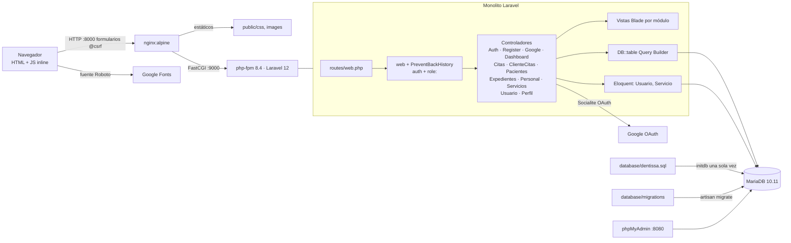

# Arquitectura de Dentissa

## Resumen
Monolito Laravel 12 con MVC clásico que renderiza HTML en el servidor con Blade (aplicación
multipágina, sin API ni SPA). Casi toda la lógica de negocio y el acceso a datos viven dentro de
13 controladores. La primera pieza de servicio es `app/Agenda/ReservaCitas.php` (spec 025), con la
regla de agenda; no hay repositorios, Policies, Form Requests, eventos ni jobs.
El acceso a datos es casi siempre Query Builder (`DB::table` con joins manuales); solo `usuarios`
y `servicios` tienen modelo Eloquent. La autorización combina un middleware propio `role:` con
comprobaciones sueltas en cada controlador. El esquema del dominio no está en migraciones: vive
en el volcado `database/dentissa.sql`, que Docker carga al inicializar la base.

## Diagrama de componentes

## Módulos
| Módulo | Ruta | Responsabilidad | Depende de |
|---|---|---|---|
| Autenticación | `app/Http/Controllers/AuthController.php`, `GoogleAuthController.php` | Login con correo, logout, OAuth con Google | `usuarios`, Socialite |
| Registro | `app/Http/Controllers/RegisterController.php` | Autorregistro de pacientes en dos pasos y asignación automática de dentista | `usuarios`, `pacientes`, `personal` |
| Paneles | `app/Http/Controllers/DashboardController.php` | Un panel por rol | `citas`, `pacientes`, `asistente_dentista` |
| Agenda (personal) | `app/Http/Controllers/CitasController.php` | Listado, alta, detalle, estado, notas y cancelación de citas con alcance por rol; el alta delega la regla de agenda en `app/Agenda/ReservaCitas.php` | `citas`, `horarios_dentista`, `historial_citas`, `servicios`, `expedientes` |
| Agenda (cliente) | `app/Http/Controllers/ClienteCitasController.php` | Mis citas, agendar y cancelar; agendar delega la regla de agenda en `app/Agenda/ReservaCitas.php` | `citas`, `horarios_dentista`, `servicios` |
| Agenda (regla) | `app/Agenda/ReservaCitas.php`, `app/Agenda/CitaNoAgendable.php` | Regla de agenda única (horario del día, encaje en la franja, solape estricto) y guardado de la cita en una transacción que bloquea primero la fila del dentista (spec 025) | `personal` (bloqueo), `horarios_dentista`, `citas` |
| Pacientes | `app/Http/Controllers/PacientesController.php` | CRUD de pacientes y alta de su usuario | `usuarios`, `pacientes`, `expedientes`, `citas` |
| Expedientes | `app/Http/Controllers/ExpedientesController.php` | Expediente clínico ligado a una cita | `expedientes`, `citas` |
| Personal | `app/Http/Controllers/PersonalController.php` | CRUD de personal, horarios, asignación asistente↔dentista | `personal`, `usuarios`, `horarios_dentista`, `asistente_dentista` |
| Servicios | `app/Http/Controllers/ServiciosController.php` | Catálogo (Eloquent + `Route::resource`) | `servicios` |
| Usuarios | `app/Http/Controllers/UsuarioController.php` | Administración de cuentas y roles | `usuarios` |
| Perfil | `app/Http/Controllers/PerfilController.php` | Perfil y contraseña del cliente | `usuarios`, `pacientes` |
| Middleware | `app/Http/Middleware/RoleMiddleware.php`, `PreventBackHistory.php` | Rol por grupo de rutas; cabeceras no-cache | `usuarios.rol` |

Los controladores no se llaman entre sí; se acoplan a través del esquema compartido. Los mismos
controladores sirven a varios roles bajo prefijos `/admin`, `/dentista`, `/asistente`; `/cliente`
tiene su propio grupo.

## Flujo principal
Ejemplo: el personal agenda una cita.
1. El navegador envía `POST /admin/citas` con `@csrf` a nginx (puerto 8000).
2. nginx lo pasa por FastCGI a php-fpm (`app:9000`).
3. Laravel aplica el grupo `web` (incluye `PreventBackHistory`), luego `auth` y `role:admin`.
4. `CitasController@store` valida la entrada (fecha, hora y dentista activo, con las reglas
   comunes de `ReservaCitas`), comprueba el alcance por rol y llama a `ReservaCitas::reservar`. En
   una transacción, el servicio bloquea la fila del dentista, revisa `horarios_dentista` y los
   solapes, e inserta la cita. Un rechazo vuelve al formulario como error del campo hora.
5. Responde `redirect()` con flash `success`, que muestra `layouts/app.blade.php`.
Al cambiar el estado de una cita, el trigger `trg_historial_cita` escribe en `historial_citas`.

## Datos
- Motor: MariaDB 10.11 en Docker (el volcado se generó con 10.4.32). PKs UUID `char(36)`.
  Columnas `creado_en`/`actualizado_en` escritas a mano (sin timestamps de Laravel).
- Acceso: PDO con Query Builder (≈157 usos de `DB::` en controladores) y Eloquent solo para
  `Usuario` (modelo de autenticación, tabla `usuarios`) y `Servicio`.
- Entidades: `usuarios` (rol enum cliente/asistente/dentista/admin), `pacientes`, `personal`
  (tipo dentista/asistente/administrador), `asistente_dentista`, `horarios_dentista`, `servicios`,
  `citas` (estado enum de 6 valores), `historial_citas`, `expedientes`. Vistas SQL `v_citas_hoy` y
  `v_historial_paciente` (no las usa el código PHP).
- Esquema: las tablas de dominio, las vistas y el trigger solo existen en `database/dentissa.sql`.
  Las migraciones crean tablas de infraestructura (`users`, `sessions`, `cache`, `jobs`…) y
  `asistente_dentista`, y alteran `usuarios` y `pacientes`, que ninguna migración crea. El
  esquema no se puede recrear desde migraciones sobre una base vacía.

## Integraciones externas
- Google OAuth mediante `laravel/socialite` (`/auth/google`, `/auth/google/callback`); variables
  `GOOGLE_CLIENT_ID`, `GOOGLE_CLIENT_SECRET`, `GOOGLE_REDIRECT_URI`.
- Google Fonts (Roboto) desde el navegador.
- No hay correo, colas, almacenamiento de archivos ni APIs HTTP salientes en uso.

## Frontend
- Componentes y organización: vistas Blade por módulo en `resources/views/<modulo>/`, archivos en
  kebab-case, un único layout `layouts/app.blade.php`, parciales en `partials/`. Sin componentes
  `<x-…>`. `edit` reutiliza `create` con `@include`.
- Estado: sin estado de cliente; JS inline mínimo (`@push('scripts')`) para modales y rellenar
  campos.
- Routing: rutas con nombre en `routes/web.php`; hay 50 `href="/..."` escritos a mano en vistas.
- Design tokens / sistema de diseño: CSS propio en `public/css/app.css`, `auth.css`, `citas.css`
  con variables (`--p50…--p800`, `--text`, `--border`), mucho `style=""` inline. Vite + Tailwind 4
  están declarados pero solo los usa `welcome.blade.php`, que ninguna ruta sirve.
- Accesibilidad: TODO(init): objetivo no definido (propuesto WCAG 2.1 AA).

## Backend
- Contratos de API: no hay API; el contrato es formulario HTML ↔ `$request->validate()`.
- Autenticación y autorización: sesión de Laravel (guard `web`) sobre `App\Models\Usuario`;
  middleware `role:` por grupo de rutas; comprobaciones de fila en controladores
  (`aplicarAlcanceRol`, `autorizadoParaCita`). Detalle en [security.md](security.md).
- Observabilidad: sin logs propios, sin correlación, sin auditoría; ver [observability.md](observability.md).
- Seguridad: CSRF por defecto, consultas con bindings, sin `{!! !!}`; riesgos en [security.md](security.md).

## Contrato entre capas
- Fuente de verdad: nombres de campo de los formularios Blade frente a las reglas de validación de
  cada controlador. No hay tipos ni esquemas compartidos.
- Versionado: no aplica (sin API pública).
- Cómo se regenera: no aplica.

## Despliegue
Solo existe un entorno local con Docker Compose (`app` php-fpm, `nginx`, `db` MariaDB,
`phpmyadmin`). Se planean staging y producción con despliegue manual, aún sin plataforma elegida.
Detalle en [deployment.md](deployment.md).

## Evidencia (solo si status=inferred)
| Afirmación | Archivos | Confianza |
|---|---|---|
| MVC sin capa de dominio | `app/Http/Controllers/*`, `app/Providers/AppServiceProvider.php` | alta |
| Solo 2 modelos de dominio | `app/Models/Usuario.php`, `app/Models/Servicio.php` | alta |
| Autorización por rol + checks inline | `bootstrap/app.php`, `app/Http/Middleware/RoleMiddleware.php`, `CitasController.php` | alta |
| Esquema solo en volcado | `database/dentissa.sql`, `database/migrations/*`, `database/testing/bootstrap-test-db.sh` | alta |
| Vite/Tailwind sin uso real | `vite.config.js`, `resources/views/welcome.blade.php`, `layouts/app.blade.php` | alta |
| Integración Google OAuth | `GoogleAuthController.php`, `config/services.php` | alta |
| Entorno solo local | `docker-compose.yml`, `Dockerfile`, `docker/nginx/dentissa.conf` | alta |

## Deuda técnica y riesgos observados
- Esquema del dominio no reproducible desde migraciones; el volcado está desfasado respecto a las
  3 migraciones de julio (→ roadmap objetivo 1, spec 013).
- Ayudante de dentistas disponibles copiado en 2 sitios y consulta base de citas en 4.
- `historial_citas` recibe dos filas por un cambio de estado con motivo (trigger + controlador).
- Restos del esqueleto: `App\Models\User`, tabla `users`, `DatabaseSeeder`, `welcome.blade.php`,
  nombre `laravel/laravel` en `composer.json`, README genérico.
- `Route::resource('servicios')` registra `show`, que el controlador no implementa.
- Convenciones inconsistentes de rutas (`/crear` vs `/create`, `/edit` vs `/editar`, nombres con y
  sin `.index`).
- `docker-compose.yml` monta `./docker/php/local.ini`, pero el archivo está en `docker/nginx/php/local.ini`.
