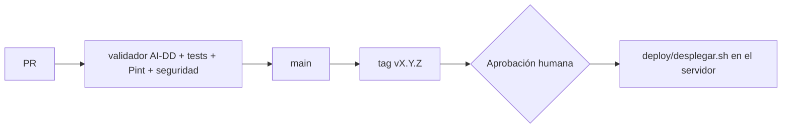

# Despliegue de Dentissa

> Regla innegociable: ningún deploy a producción sin aprobación humana explícita.

Hay dos entornos: el local de cada integrante, con Docker Compose, y producción, en el servidor
propio del responsable del proyecto (Ubuntu Server 24.04), expuesto a internet solo por un túnel de
Cloudflare (spec 030, [ADR 0005](adr/0005-produccion-servidor-propio-cloudflare-tunnel.md)).
Staging no existe: el único servidor es producción (decisión del usuario, 2026-10-03).

## Entornos
| Entorno | URL | Rama / disparador | Aprobación | Datos |
|---|---|---|---|---|
| dev (local) | http://localhost:8000 (phpMyAdmin :8080), solo desde el propio equipo | cualquier rama, `docker compose up -d` | ninguna | ficticios (volcado `database/dentissa.sql`) |
| staging | — (no existe; pendiente, RD1.d, RD3.d) | — | — | — |
| prod | https://dentissa.app (túnel de Cloudflare) | manual, `deploy/desplegar.sh vX.Y.Z` desde el tag | **humana: el responsable del proyecto (gimi34)** (decisión del usuario, 2026-09-28) | ficticios (proyecto académico), con las contraseñas del volcado rotadas |

**Ensayos sin exposición** (spec 030, D13): durante `/implement`, con el túnel parado, se puede
desplegar en el servidor un commit de la rama para ensayar copia, restauración, vuelta atrás y
reinicio. Cada ensayo exige antes la aprobación explícita del responsable, anotada en `tasks.md`.
Nadie de fuera llega a la aplicación mientras `cloudflared` está parado.

## Plataforma e infraestructura
- **Local:** `Dockerfile` (`php:8.4.26-fpm` + extensiones pdo_mysql, mbstring, exif, pcntl, bcmath,
  gd, zip; Composer desde `composer:2.10.3`), `docker-compose.yml` con `app`, `nginx`
  (`nginx:1.30.5-alpine`, `127.0.0.1:8000`), `db` (`mariadb:10.11.19`, `127.0.0.1:3306`, colación
  `utf8mb4_unicode_ci`, volumen `dentissa_db_data`, carga el volcado solo la primera vez) y
  `phpmyadmin` (`phpmyadmin:5.2.3`, `127.0.0.1:8080`). PHP lee `docker/nginx/php/local.ini`.
  Configuración nginx en `docker/nginx/dentissa.conf`. Todas las imágenes con versión exacta.
- **Producción** (ADR 0005): servidor propio con Ubuntu Server 24.04, Docker Engine y
  `docker-compose.prod.yml` (proyecto `dentissa-prod`):
  - `cloudflared` (`cloudflare/cloudflared:2026.10.2`): túnel saliente hacia Cloudflare, única
    entrada; HTTPS en el borde de Cloudflare.
  - `web` (nginx de `docker/prod/Dockerfile`, etapa `web`): `public/` y
    `docker/nginx/dentissa.prod.conf`; toma la IP real de `CF-Connecting-IP` solo desde la red
    `172.28.0.0/24` y redirige con 301 a `https://` lo que llega por `http://`.
  - `app` (php-fpm de `docker/prod/Dockerfile`, etapa `app`): el código dentro de la imagen, sin
    dependencias de desarrollo ni secretos, con los paquetes del sistema actualizados al construir.
  - `db` (`mariadb:10.11.19`): usuario propio `dentissa_app` (no root), colación
    `utf8mb4_unicode_ci`, volumen `db_data`; el volcado solo en la primera carga.
  - Ningún servicio publica puertos; `restart: unless-stopped`; volúmenes `db_data`, `storage`
    (logs de Laravel y sesiones) y `nginx_logs`.
  - Servidor: `ufw` deniega todo lo entrante salvo SSH desde la red local; SSH solo con clave y sin
    root; actualizaciones automáticas de seguridad (`deploy/preparar-servidor.sh`).
  - Código: clon de GitHub con deploy key de solo lectura en `/opt/dentissa/app`.
  - Secretos: `app.env`, `db.env` y `tunnel.env` en `/opt/dentissa/entorno` (carpeta 700, archivos
    600, fuera del clon); cada servicio lee solo el suyo.
- Guía paso a paso del servidor: [`deploy/README.md`](../deploy/README.md).

## Pipeline

- `.github/workflows/ai-dd.yml` (creado por `/init`, decisión del usuario, 2026-09-28): valida
  los artefactos del flujo, corre tests y Pint sobre los archivos cambiados y los escáneres de
  seguridad en modo baseline (solo hallazgos nuevos del PR); job semanal informativo del repo
  completo. No despliega.
- Rama única `main`; trabajo en ramas `feature/NNN-slug` con PR (Conventional Commits, decisión
  del usuario, 2026-09-28) y en ramas `chore/<tema>` para cierres, actualizaciones del flujo y
  mantenimiento, también con PR (decisión del usuario, 2026-10-18).
- El despliegue es manual: lo ejecuta el responsable por SSH en el servidor (spec 030, D6).

## Cómo desplegar
```bash
# Local (dev)
docker compose up -d
docker compose exec app composer install
docker compose exec app php artisan migrate      # aplica las migraciones sobre el volcado (incluida la de la spec 026)

# Producción, en el servidor por SSH, solo con aprobación humana explícita
cd /opt/dentissa/app
bash deploy/desplegar.sh vX.Y.Z                  # copia, checkout, build, db, migrate, app y web, cachés, verificación interna
bash deploy/verificar.sh                         # con el túnel abierto: también por la dirección pública
```
`desplegar.sh`, en orden: árbol limpio; copia de la base con `respaldar.sh` si la base tiene datos
(el primer despliegue lo anuncia y sigue sin copia); `git fetch --tags` y `checkout`; construcción
de `app` y `web` sin caché y bajando las imágenes base (`--no-cache --pull`, spec 031: así la capa de
`apt-get upgrade` / `apk upgrade` se renueva y las correcciones del sistema llegan a producción); `db` sana; `migrate --force` con la imagen nueva; `up -d app web`; cachés;
`verificar.sh --interna`. Nunca arranca ni para `cloudflared`: el túnel se abre a mano la primera
vez (`docker compose -f docker-compose.prod.yml up -d cloudflared`) y desde entonces vuelve solo
tras un reinicio. Tiempo ensayado: 86 s el primer despliegue y 10 s uno posterior, sin la
verificación (spec 030, T040 y T044). Desde la spec 031, cada despliegue reconstruye todo sin caché
y con `REFRESCO_SISTEMA` nuevo: medido en el ensayo del 2026-10-19 (spec 031, T040), 376 s de
construcción (`apt-get upgrade` 193 s, `composer install` 136 s) y 418 s en total. `volver.sh` sigue
construyendo con caché: en una vuelta atrás importa la rapidez (22 s en el mismo ensayo) y la versión
anterior ya se construyó antes.

Cambiar un archivo de entorno (`app.env`, `db.env`, `tunnel.env`): editarlo y después
`bash deploy/aplicar-entorno.sh <servicio>`, que recrea ese contenedor (un `restart` no relee el
archivo) y verifica; `verificar.sh` da FALLO en «Entorno aplicado» si un servicio usa una
configuración distinta de la guardada o si no puede comparar alguno (spec 031, CA7, /review R1;
guía `deploy/README.md` §10).

Administrar desde fuera de casa: SSH con clave por la red privada de Tailscale, instalada con
`sudo bash deploy/preparar-acceso-remoto.sh` (spec 031, CA8; ADR 0006; guía §11, que también dice
cómo retirar un dispositivo). Sin puertos abiertos en el router.

**Servicio `scheduler` (spec 020):** ejecuta `php artisan schedule:work`, cuya única tarea es la
purga mensual del registro de auditoría (`auditoria:purgar`, el día 1 a las 03:00 UTC). En local
usa el mismo `build:` que `app`; en producción, la imagen que construye `app`
(`dentissa-prod-app:produccion`, `pull_policy: never`), con `www-data`, solo `app.env`, el mismo
`local.ini` y sin puertos. Se reinicia solo. `desplegar.sh` y `volver.sh` lo levantan con `app` y
`web` (`--remove-orphans`); `volver.sh` lo para antes del checkout y `restaurar.sh` mientras carga
la copia; los tres lo nombran solo si la versión de destino lo tiene. `aplicar-entorno.sh app` lo
recrea también, porque lee el mismo `app.env`. `verificar.sh` comprueba que está en marcha y que
`schedule:list` tiene `auditoria:purgar`. `dentissa:vigilar` sigue en su temporizador de systemd.

**Primera liberación de la 020 (una sola vez):** el `desplegar.sh` instalado no conoce el
`scheduler`. Se anota la versión instalada (`git describe --tags`), se hace el checkout del tag a
mano y después `bash deploy/desplegar.sh <tag>`, que ya lo levanta; como el checkout está hecho,
el script informa como «anterior» el propio tag, y la vuelta es a la versión anotada
(`deploy/README.md` §9): `bash deploy/volver.sh <versión anotada>`, **sin la copia**. Si la
verificación falla, **no se sigue la orden de `restaurar.sh` que imprime `desplegar.sh`**: su
«anterior» es el propio tag y su copia, tomada antes de la migración, no tiene la tabla
`auditoria`; con ella se volvería a levantar la 020 sin su tabla (/review 020 R3).

Tras el primer despliegue: `docker compose -f docker-compose.prod.yml exec -u www-data app php artisan
dentissa:rotar-credenciales --confirmar` (las contraseñas nuevas se muestran una vez y se guardan
fuera del repositorio y del chat).

## Migraciones de base de datos
- Cuándo se aplican: en local, a mano con `php artisan migrate` después de que Docker cargue el
  volcado. En producción, `desplegar.sh` las aplica después de la copia y antes de cambiar el
  tráfico, con la imagen nueva (`docker compose run --rm -u www-data app php artisan migrate --force`).
- Patrón: expand → migrate → contract (compatibles con la versión anterior)
- Comando: `php artisan migrate --force`
- Limitación actual: el esquema del dominio solo existe en `database/dentissa.sql`; las
  migraciones no pueden crear la base desde cero (ver RD2). Una base nueva necesita la colación
  `utf8mb4_unicode_ci` para que el volcado cargue entero (spec 030, T015 y T034).
- Spec 026: la migración `2026_10_02_000000_retirar_trigger_historial_cita` va en el mismo paso que
  el código. Sin ella, el código nuevo y el trigger escribirían dos filas de historial; con ella y
  el código anterior, los cambios de estado quedarían sin historial. Rollback:
  `php artisan migrate:rollback --step=1` (recrea el trigger) y volver a desplegar la versión
  anterior.
- Spec 028: la migración `2026_10_07_000000_reprogramacion_en_historial_citas` solo añade a
  `historial_citas` `fecha_hora_anterior` y `fecha_hora_nueva` (`DATETIME NULL`) y va en el mismo
  paso que el código. El código anterior ignora las columnas, así que la vuelta atrás
  (`deploy/volver.sh <tag anterior>`) no necesita revertirla ni restaurar la copia; las entradas de
  reprogramación siguen en la tabla y la versión anterior las muestra como un cambio de estado sin
  fechas.
- Spec 020: la migración `create_auditoria_table` crea la tabla `auditoria` y sus triggers
  `auditoria_sin_update` y `auditoria_sin_delete` con el usuario de la aplicación (`dentissa_app`,
  sin root): MariaDB 10.11 sin binlog no exige `SUPER` para crear triggers, y `dentissa_app` tiene
  `ALL` sobre su base. Solo añade, así que la vuelta atrás es `deploy/volver.sh <tag anterior>`
  **sin revertirla y sin la copia**: la versión anterior ignora la tabla y los eventos escritos
  desde el despliegue son evidencia. Con la copia se perderían. `down()` solo se usa en desarrollo.
  La purga mide en UTC (`UTC_TIMESTAMP()` en el trigger y `ocurrido_en` en UTC), así que los
  relojes del servidor y de la base deben estar sincronizados (NTP): con un desfase, un evento
  dentro del margen haría fallar la purga entera.
- Base de tests: `database/testing/bootstrap-test-db.sh` recarga el volcado, que trae el trigger, y
  no ejecuta migraciones. Después hay que ejecutar
  `docker compose exec -e DB_DATABASE=dentissa_test app php artisan migrate --force`; si no,
  `HistorialCitaTest` encontrará dos filas por cambio. El CI ya ejecuta `migrate` tras cargar el
  volcado.

## Copias de seguridad
Cifradas desde la spec 032 ([ADR 0007](adr/0007-copias-cifradas-y-avisos.md)):
- `deploy/respaldar.sh`: `mariadb-dump` dentro de `db` (sin contraseñas en la línea de comandos), en
  la misma tubería por `gzip` y `gpg --recipient-file` con la clave pública del responsable
  (`/opt/dentissa/entorno/copias.pub.asc`), a
  `/var/backups/dentissa/dentissa-AAAAMMDD-HHMMSS.sql.gz.gpg` (carpeta 700, copia 600): nunca hay
  volcado en claro en el disco. Sin gpg o sin una clave pública válida se detiene antes de volcar.
  Conserva las 14 más recientes y nunca pisa una copia del mismo segundo. `desplegar.sh` la ejecuta
  antes de cada despliegue.
- El servidor solo tiene la clave pública y no puede abrirlas. La clave secreta, con su frase, está
  en el PC del responsable y en una segunda copia fuera del PC; si se pierden las dos, las copias no
  se recuperan.
- Tras cada despliegue, el responsable se lleva la copia más reciente a su PC con `scp` (cifrada).
- `deploy/restaurar.sh <copia.sql.gz.gpg> <cuenta@servidor> [--volver <ref>] [--solo-comprobar]`, **en
  el PC** (Git Bash): comprueba la copia entera en local (con un mensaje distinto para una copia de
  otra clave, una frase incorrecta o cancelada, una copia alterada o cortada y un volcado
  incompleto), pide confirmación escrita y envía por SSH solo el volcado descifrado; el servidor no
  toca la base hasta recibir la primera línea. Ensayado el 2026-10-25 (spec 032, T044) con la
  segunda copia de la clave: mismas filas y `CHECKSUM TABLE` en las 14 tablas no volátiles.
- `deploy/cifrar-copias-antiguas.sh`: cifra las copias en claro anteriores a la 032 y borra las
  originales (`shred -u`); se ejecutó en el ensayo (9 copias).

## Rollback
1. Para dejar la aplicación sin exposición al instante:
   `docker compose -f docker-compose.prod.yml stop cloudflared`.
2. Volver a la versión anterior: `bash deploy/volver.sh <tag anterior>`.
3. Si la versión que se abandona migró la base, desde el PC (spec 032): `scp` de la copia que dejó
   `desplegar.sh` y `bash deploy/restaurar.sh <copia> <cuenta@servidor> --volver <tag anterior>`.
   `restaurar.sh` comprueba la copia, llama a `volver.sh <tag anterior> --sin-levantar` (app y web
   parados, db sana), carga la copia y levanta la versión anterior. `desplegar.sh` imprime la orden
   exacta según haya o no migraciones pendientes (`migrate:status --pending`). La forma de la 030
   (`volver.sh <tag> <copia>`) ya no restaura.
4. Si la versión de destino es anterior a la 032, parar el temporizador de avisos:
   `sudo systemctl disable --now dentissa-vigilar.timer` (`volver.sh` lo avisa).
5. Desde la spec 020, el `scheduler` se para antes del checkout y se levanta al final solo si la
   versión de destino lo tiene; hacia una versión anterior a la 020, el contenedor se quita
   (`--remove-orphans`). La vuelta de la propia 020 va sin la copia (ver Migraciones).
- Tiempo ensayado: 4 min 44 s con la copia cifrada desde el PC (spec 032, T044); 27 s sin cifrar en
  la 030 (T044); objetivo, 15 minutos o menos.
- Con la copia, se pierde todo lo escrito en la base desde el despliegue, y no se avisa (RD8.a).
- Si hubo migración no compatible y no hay copia: **antes** de `volver.sh`, con la versión que se
  abandona todavía en marcha, `docker compose -f docker-compose.prod.yml exec app php artisan
  migrate:rollback --step=N`; después, `volver.sh <tag anterior>`. La imagen anterior ya no trae los
  archivos de esas migraciones y no puede revertirlas.

## Hotfix
Lo usa `/fix --hotfix` para un incidente en producción (decisión del usuario, 2026-10-18):
- Rama: `hotfix/<slug>` desde el tag que está en producción (`vX.Y.Z`), sin arrastrar lo que haya
  en `main` sin liberar.
- Staging: no existe; directo a producción con el smoke de `deploy/verificar.sh` y la misma
  aprobación humana explícita que un `/release`. Se libera con un tag de parche (`vX.Y.Z+1`) y
  `deploy/desplegar.sh` en el servidor.
- Vuelta a la rama principal: PR de la rama `hotfix/<slug>` a `main` después de producción.

## Variables de entorno
| Nombre | dev | staging | prod | Dónde se configura |
|---|---|---|---|---|
| APP_NAME, APP_ENV, APP_KEY, APP_DEBUG, APP_URL | ✓ | — | ✓ | `.env` local · `app.env` en el servidor |
| APP_LOCALE, APP_FALLBACK_LOCALE, APP_FAKER_LOCALE, BCRYPT_ROUNDS | ✓ | — | ✓ (valores por defecto) | `.env` · `app.env` |
| CLINICA_ZONA_HORARIA (zona de la hora de las citas; por defecto America/Mexico_City; spec 026) | ✓ | — | ✓ (valor por defecto) | `.env` · `app.env` |
| LOG_CHANNEL, LOG_STACK, LOG_DEPRECATIONS_CHANNEL, LOG_LEVEL | ✓ | — | ✓ (`LOG_LEVEL=info`) | `.env` · `app.env` |
| DB_CONNECTION, DB_HOST, DB_PORT, DB_DATABASE, DB_USERNAME, DB_PASSWORD | ✓ | — | ✓ (`DB_USERNAME=dentissa_app`) | `.env` · `app.env` |
| SESSION_DRIVER, SESSION_LIFETIME, SESSION_ENCRYPT, SESSION_PATH, SESSION_DOMAIN, SESSION_SECURE_COOKIE | ✓ | — | ✓ (`file`, `SESSION_SECURE_COOKIE=true`) | `.env` · `app.env` |
| GOOGLE_CLIENT_ID, GOOGLE_CLIENT_SECRET, GOOGLE_REDIRECT_URI | ✓ | — | ✓ (redirect en https) | `.env` · `app.env` |
| CACHE_STORE | ✓ | — | ✓ (`database`: los límites de intentos necesitan un almacén compartido) | `.env` · `app.env` |
| QUEUE_CONNECTION, FILESYSTEM_DISK | ✓ | — | — | `.env` (sin uso real hoy) |
| MAIL_MAILER, MAIL_HOST, MAIL_PORT, MAIL_USERNAME, MAIL_PASSWORD, MAIL_FROM_ADDRESS, MAIL_FROM_NAME (spec 032) | ✓ (`MAIL_MAILER=log`) | — | ✓ (`smtp`, `smtp.gmail.com`, `465`, cuenta de Gmail solo para enviar, contraseña de aplicación) | `.env` · `app.env` |
| AVISOS_CORREO (destino de los avisos; spec 032) | vacío | — | ✓ | `.env` · `app.env` |
| DENTISSA_CLAVE_PUBLICA (clave pública de las copias; por defecto `/opt/dentissa/entorno/copias.pub.asc`; spec 032) | — | — | opcional | entorno del shell que ejecuta `respaldar.sh`, `cifrar-copias-antiguas.sh`, `preparar-vigilancia.sh` y `verificar.sh` |
| DENTISSA_APP (clon del servidor que usa `restaurar.sh` desde el PC; por defecto `/opt/dentissa/app`; spec 032) | — | — | opcional | Git Bash del PC del responsable |
| MARIADB_PASSWORD, MARIADB_ROOT_PASSWORD | — | — | ✓ | `db.env` en el servidor (solo el servicio `db`) |
| TUNNEL_TOKEN | — | — | ✓ | `tunnel.env` en el servidor (solo `cloudflared`) |
| DENTISSA_ENV_DIR (carpeta de los archivos de entorno; por defecto `/opt/dentissa/entorno`) | — | — | opcional | entorno del shell que ejecuta Compose |
| DENTISSA_BACKUP_DIR (destino de las copias; por defecto `/var/backups/dentissa`) | — | — | opcional | entorno del shell que ejecuta `deploy/respaldar.sh` |
| MARIADB_DATABASE, MARIADB_USER (no son secretos) | — | — | ✓ | fijadas en `docker-compose.prod.yml` |
| TEST_DB_SERVICE, TEST_DB_NAME, TEST_DB_USER, TEST_DB_PASSWORD | ✓ (opcionales) | — | — | arnés `database/testing/bootstrap-test-db.sh` |

(Solo nombres. Nunca valores. En el servidor, cada archivo de entorno con permisos 600 y fuera del clon.)

## Verificación post-deploy
- `bash deploy/verificar.sh --interna` (lo ejecutan `desplegar.sh` y `volver.sh`) y, con el túnel
  abierto, `bash deploy/verificar.sh`. Comprueba, sin mostrar secretos: servicios en marcha;
  `GET /up` 200; `APP_ENV=production`, `APP_DEBUG=false`, `LOG_LEVEL=info`, `APP_KEY` definida,
  `CACHE_STORE` distinto de `array`, `SESSION_SECURE_COOKIE=true`, `APP_URL` y
  `GOOGLE_REDIRECT_URI` en https; usuario de la base distinto de root y que la app no se conecta como
  root; que ninguna contraseña del README autentica; ningún puerto
  publicado ni nada escuchando fuera de localhost salvo SSH (y las direcciones de la red privada);
  `local.ini` aplicado; desde la spec 031, `GOOGLE_CLIENT_ID` con formato de Google y
  `GOOGLE_CLIENT_SECRET` sin el texto de ejemplo, las cabeceras de seguridad de `/login`, los
  estáticos, la 404 y la 301, «Entorno aplicado» en los cuatro servicios y la red privada conectada
  con SSH solo por clave; y en modo público, `/up` 200, redirección de `/` a https,
  `http://<host>/login` → 301 a `https://` y las cabeceras de `https://<host>/login`. Las versiones
  anteriores a la 031 dan un FALLO conocido en «nada escucha fuera de localhost salvo SSH» por
  `tailscaled` (spec 031, CA8). Desde la spec 032, la configuración comprueba también el envío de
  avisos (`MAIL_MAILER=smtp`, host y puerto 465, usuario y contraseña sin el texto de ejemplo,
  `MAIL_FROM_ADDRESS` y `AVISOS_CORREO` con formato de correo: 16 comprobaciones) y, solo sin
  `--interna`, la sección «Avisos y copias»: temporizador activo, clave pública válida y sin clave
  secreta, llavero del servidor sin claves secretas, ninguna copia en claro en
  `/var/backups/dentissa` ni en la carpeta personal, y que `app` lee el log de acceso. Desde la
  spec 020, también el `scheduler` en marcha, «Tareas programadas» con `auditoria:purgar` y
  «Entorno aplicado» en los cinco servicios.
- Correlación y auditoría (spec 020): una petición con un `X-Request-Id` válido lo devuelve en la
  respuesta; tras entrar como dentista a `/admin`, el admin encuentra en `/admin/auditoria` el
  `acceso_denegado` con ese `request_id` y la acción solicitada `admin.dashboard`.
- Avisos (spec 032): aviso de prueba con
  `docker compose -f docker-compose.prod.yml exec -T -u www-data app php artisan dentissa:vigilar --prueba`
  (llega en menos de 5 minutos) y monitor de UptimeRobot en verde.
- Smoke tests: login de una cuenta de prueba por rol, agendar y cancelar una cita ficticia. Sin
  exponer, por túnel SSH al contenedor `web` (`http://localhost:<puerto>`, ver `deploy/README.md`).
- Health check: `GET /up` (hoy no comprueba la BD; ver OB6).
- Logs: `storage/logs/laravel.log` en el volumen `storage` y `dentissa-access.log` /
  `dentissa-error.log` de nginx en el volumen `nginx_logs`; se conservan tras reiniciar el servidor
  (ensayado, spec 030, T045); desde la spec 032, `storage/logs/seguridad-AAAA-MM-DD.log` (fallos de
  acceso, 14 días) y el journal del temporizador (`journalctl -u dentissa-vigilar`). Métricas:
  ninguna · Alertas: errores del servidor, inicios de sesión fallidos, log de acceso con otro formato
  y caída vista desde fuera, por correo (ver [observability.md](observability.md)).
- Trazabilidad: busca por `request_id` una petición de los smoke tests y confirma que sus logs
  y eventos de auditoría llegan al destino esperado (cuando exista la correlación, OB2).

## Riesgos conocidos
<!-- IDs `RD<n>` y correcciones `RD<n>.<letra>`, con el mismo formato que docs/security.md. -->
### RD1 · Alta — Sin rollback ni backups de base de datos
Hasta la spec 030 no había procedimiento para revertir un deploy ni copias de la BD. La 030 añade
copias, restauración y vuelta atrás ensayadas en producción; lo que pide staging sigue pendiente
(/analyze 030 A1: RD1.a se divide en producción y staging). → roadmap objetivo 5.

Correcciones:
- RD1.a Backup scriptado de la BD antes de cada deploy y restauración probada, en producción — estado: mitigada (v0.5.0)
- RD1.b Procedimiento documentado y ensayado de redeploy del tag anterior — estado: mitigada (v0.5.0)
- RD1.c Toda migración nueva con `down()` probado en staging — estado: pendiente
- RD1.d Restauración del backup probada en staging — estado: pendiente (→ objetivo 5, cuando exista staging)

### RD2 · Alta — Esquema del dominio no reproducible desde migraciones
Las 9 tablas de dominio, las vistas y el trigger solo existen en `database/dentissa.sql`; las
migraciones alteran tablas que nadie crea; el volcado no tiene `asistente_dentista`,
`usuarios.google_id` ni `pacientes.dentista_id`, y la base de tests se carga solo desde el
volcado. → roadmap objetivo 1, spec 013.

Correcciones:
- RD2.a Migraciones que creen todas las tablas de dominio, vistas y (si se mantiene) el trigger — estado: pendiente
- RD2.b Seeder con datos sintéticos que sustituya al volcado — estado: pendiente
- RD2.c Base de tests creada con `migrate` + seeder, no con el volcado — estado: pendiente
- RD2.d Retirar el volcado de `docker-entrypoint-initdb.d` — estado: pendiente

### RD3 · Media — Staging y producción sin plataforma ni configuración
La spec 030 elige la plataforma (servidor propio con Cloudflare Tunnel, ADR 0005) y crea la
configuración de producción con HTTPS; staging sigue sin existir (/analyze 030 A1: RD3.c se divide
en producción y staging). → roadmap objetivo 5.

Correcciones:
- RD3.a Elegir plataforma gratuita y registrarla en un ADR — estado: mitigada (v0.5.0)
- RD3.b Configuración de producción (Compose de prod o equivalente) con `APP_ENV=production`, `APP_DEBUG=false` y secretos — estado: mitigada (v0.5.0)
- RD3.c TLS en producción — estado: mitigada (v0.5.0)
- RD3.d TLS en staging — estado: pendiente (→ objetivo 5, cuando exista staging)

### RD4 · Media — Configuración de PHP no se aplica en Docker
`docker-compose.yml` montaba `./docker/php/local.ini`, que en el repo no existe (Docker crea una
carpeta vacía); el archivo real está en `docker/nginx/php/local.ini` (límites de subida, zona
horaria). La spec 030 corrige el montaje en los dos Compose.
**Mitigado en v0.5.0 (spec 030, 2026-10-04):** RD4.a mitigada.

Correcciones:
- RD4.a Corregir la ruta del montaje o mover el archivo — estado: mitigada (v0.5.0)

### RD5 · Baja — Build de assets sin versión de Node fijada
Node no está fijado (`.nvmrc`/`engines`) y el Dockerfile no lo instala; Vite y Tailwind apenas se
usan (solo `welcome.blade.php`). → roadmap objetivo 5.

Correcciones:
- RD5.a Decidir en un ADR si se adopta Vite (y fijar Node) o se retira la cadena Vite/Tailwind — estado: pendiente

### RD7 · Media — Versión de PHP declarada no coincide con el lock
`composer.json` declara `"php": "^8.2"`, pero `composer.lock` fija `symfony/*` 8.1 que exige
PHP ≥ 8.4.1 (y PHPUnit 12 ≥ 8.3). Con PHP 8.2 fuera de Docker la app no arranca (verificado en
`/init`, 2026-09-28: `platform_check.php` aborta). Solo funciona en la imagen php:8.4. → roadmap objetivo 5.

Correcciones:
- RD7.a Alinear la versión: declarar `"php": "^8.4"` (y `config.platform.php`) o regenerar el lock para 8.2, y documentarlo — estado: pendiente

### RD6 · Media — CI sin fijar a versiones exactas
`/init` creó `.github/workflows/ai-dd.yml` (2026-09-28) y corre en cada PR, pero sus acciones van por
etiqueta (`@v4`, `@v2`) aunque su cabecera diga que están fijadas a SHA, quedan los `TODO` de
verificar las imágenes de los escáneres. → roadmap objetivo 5.

Correcciones:
- RD6.a Fijar las acciones del workflow a SHA y confirmar que el job de tests pasa en GitHub Actions — estado: en curso (el job de tests pasa: CI en verde en el PR de la 034, confirmado por el usuario, 2026-10-16; faltan los SHA)

### RD8 · Media — La vuelta atrás con copia pierde datos sin avisar
Detectado en la re-sincronización del 2026-10-18. `volver.sh <tag> <copia>` restaura la copia que dejó
`desplegar.sh` sin avisar de que se pierde lo escrito desde el despliegue y sin copia previa del
estado actual; tampoco comprueba que el árbol esté limpio, como sí hace `desplegar.sh`. Las copias
solo se hacen al desplegar o a mano (sin copia diaria, decisión del usuario en la spec 032).
Evidencia: `deploy/volver.sh`, `deploy/desplegar.sh`.

Correcciones:
- RD8.a `volver.sh` con copia avisa de la pérdida, pide confirmación escrita y hace antes una copia del estado actual — estado: pendiente (→ objetivo 5)
- RD8.b `volver.sh` comprueba que el árbol del clon esté limpio, como `desplegar.sh` — estado: pendiente (→ objetivo 5)

### RD9 · Baja — El CI prueba con otra versión de MariaDB
Detectado en la re-sincronización del 2026-10-18. El servicio de tests del CI usa `mariadb:10.11`
sin fijar el parche, mientras local y producción usan `10.11.18`, y `ConfiguracionProduccionTest`
solo vigila los Compose. Evidencia: `.github/workflows/ai-dd.yml`.

Correcciones:
- RD9.a Fijar la imagen de MariaDB del CI a la misma versión que local y producción — estado: pendiente (→ objetivo 5)
