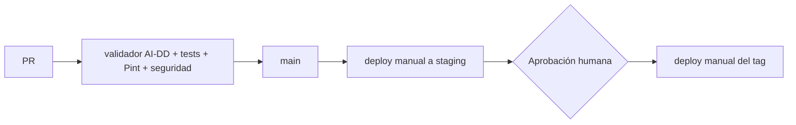

# Despliegue de Dentissa

> Regla innegociable: ningún deploy a producción sin aprobación humana explícita.

Hoy solo existe el entorno local con Docker Compose. Staging y producción están planificados
(decisión del usuario, 2026-09-28), sin plataforma elegida todavía (sin presupuesto).

## Entornos
| Entorno | URL | Rama / disparador | Aprobación | Datos |
|---|---|---|---|---|
| dev (local) | http://localhost:8000 (phpMyAdmin :8080) | cualquier rama, `docker compose up -d` | ninguna | ficticios (volcado `database/dentissa.sql`) |
| staging | TODO(init) | manual, desde `main` | el equipo | sintéticos (seeder) |
| prod | TODO(init) | manual, desde un tag `vX.Y.Z` | **humana: el responsable del proyecto (gimi34)** (decisión del usuario, 2026-09-28) | ficticios (proyecto académico) |

## Plataforma e infraestructura
- Local: `Dockerfile` (php:8.4-fpm + extensiones pdo_mysql, mbstring, exif, pcntl, bcmath, gd,
  zip; Composer desde `composer:latest`), `docker-compose.yml` con `app`, `nginx` (8000:80),
  `db` (mariadb:10.11, 3306 publicado, volumen `dentissa_db_data`, carga el volcado en
  `docker-entrypoint-initdb.d` solo la primera vez) y `phpmyadmin` (8080). Configuración nginx en
  `docker/nginx/dentissa.conf`. Sin IaC.
- Staging y prod: TODO(init) plataforma por definir. Opciones gratuitas a evaluar en un ADR:
  VPS educativo con el mismo Compose endurecido, o un PaaS con capa gratuita (Render, Railway,
  Fly.io). Requisitos mínimos: PHP 8.2+, MariaDB/MySQL, TLS, variables de entorno como secretos,
  backups de BD.

## Pipeline

- `.github/workflows/ai-dd.yml` (creado por `/init`, decisión del usuario, 2026-09-28): valida
  los artefactos del flujo, corre tests y Pint sobre los archivos cambiados y los escáneres de
  seguridad en modo baseline (solo hallazgos nuevos del PR); job semanal informativo del repo
  completo. No despliega.
- Rama única `main`; trabajo en ramas `feature/NNN-slug` con PR (Conventional Commits, decisión
  del usuario, 2026-09-28).

## Cómo desplegar
```bash
# Local (dev)
docker compose up -d
docker compose exec app composer install
docker compose exec app php artisan migrate      # aplica las 3 migraciones de julio sobre el volcado
# staging: TODO(init) — procedimiento manual a definir con la plataforma (roadmap objetivo 5)
# producción: TODO(init) — igual que staging, desde un tag vX.Y.Z y solo con aprobación humana
```

## Migraciones de base de datos
- Cuándo se aplican: hoy, a mano con `php artisan migrate` después de que Docker cargue el
  volcado. En staging/prod: después del backup y antes de cambiar el tráfico a la nueva versión.
- Patrón: expand → migrate → contract (compatibles con la versión anterior)
- Comando: `php artisan migrate --force`
- Limitación actual: el esquema del dominio solo existe en `database/dentissa.sql`; las
  migraciones no pueden crear la base desde cero (ver RD2).

## Rollback
No existe procedimiento de rollback (confirmado por el usuario, 2026-09-28). Propuesta a validar
en roadmap objetivo 5:
1. Antes de cada deploy: `mysqldump` de la base del entorno a un archivo con fecha, fuera del
   servidor de la app.
2. Si falla la verificación post-deploy: volver a desplegar el tag anterior.
3. Si hubo migración no compatible: `php artisan migrate:rollback --step=N` (probado antes en
   staging) o restaurar el backup del paso 1.
- Tiempo estimado: TODO(init)
- Si hubo migración: ver paso 3.

## Variables de entorno
| Nombre | dev | staging | prod | Dónde se configura |
|---|---|---|---|---|
| APP_NAME, APP_ENV, APP_KEY, APP_DEBUG, APP_URL | ✓ | ✓ | ✓ | `.env` local · TODO(init) gestor de la plataforma |
| APP_LOCALE, APP_FALLBACK_LOCALE, APP_FAKER_LOCALE, BCRYPT_ROUNDS | ✓ | ✓ | ✓ | `.env` |
| LOG_CHANNEL, LOG_STACK, LOG_DEPRECATIONS_CHANNEL, LOG_LEVEL | ✓ | ✓ | ✓ | `.env` |
| DB_CONNECTION, DB_HOST, DB_PORT, DB_DATABASE, DB_USERNAME, DB_PASSWORD | ✓ | ✓ | ✓ | `.env` · secretos de la plataforma |
| SESSION_DRIVER, SESSION_LIFETIME, SESSION_ENCRYPT, SESSION_PATH, SESSION_DOMAIN | ✓ | ✓ | ✓ | `.env` |
| GOOGLE_CLIENT_ID, GOOGLE_CLIENT_SECRET, GOOGLE_REDIRECT_URI | ✓ | ✓ | ✓ | `.env` · secretos de la plataforma |
| CACHE_STORE, QUEUE_CONNECTION, FILESYSTEM_DISK, MAIL_* | ✓ | ✓ | ✓ | `.env` (sin uso real hoy) |

(Solo nombres. Nunca valores.)

## Verificación post-deploy
- Health check: `GET /up` (hoy no comprueba la BD; ver OB6).
- Smoke tests: login de una cuenta de prueba por rol, abrir agenda, agendar y cancelar una cita
  ficticia. TODO(init): automatizarlos.
- Checklist de configuración: `APP_ENV=production`, `APP_DEBUG=false`, `LOG_LEVEL=info`,
  `SESSION_SECURE_COOKIE=true`, phpMyAdmin no expuesto, puertos de BD no públicos.
- Logs: `storage/logs/laravel.log` en local · Métricas: ninguna · Alertas: ninguna (ver [observability.md](observability.md))
- Trazabilidad: busca por `request_id` una petición de los smoke tests y confirma que sus logs
  y eventos de auditoría llegan al destino esperado (cuando exista la correlación, OB2).

## Riesgos conocidos
<!-- IDs `RD<n>` y correcciones `RD<n>.<letra>`, con el mismo formato que docs/security.md. -->
### RD1 · Alta — Sin rollback ni backups de base de datos
No hay procedimiento para revertir un deploy ni ninguna copia de seguridad de la BD
(`routes/console.php` sin tareas; no aparece `mysqldump`). → roadmap objetivo 5.

Correcciones:
- RD1.a Backup automático o scriptado de la BD antes de cada deploy y restauración probada en staging — estado: pendiente
- RD1.b Procedimiento documentado y ensayado de redeploy del tag anterior — estado: pendiente
- RD1.c Toda migración nueva con `down()` probado en staging — estado: pendiente

### RD2 · Alta — Esquema del dominio no reproducible desde migraciones
Las 9 tablas de dominio, las vistas y el trigger solo existen en `database/dentissa.sql`; las
migraciones alteran tablas que nadie crea; el volcado no tiene `asistente_dentista`,
`usuarios.google_id` ni `pacientes.dentista_id`, y la base de tests se carga solo desde el
volcado. → roadmap objetivo 1, spec 013.

Correcciones:
- RD2.a Migraciones que creen todas las tablas de dominio, vistas y (si se mantiene) el trigger — estado: pendiente
- RD2.b Seeder con datos sintéticos que sustituya al volcado — estado: pendiente
- RD2.c Base de tests creada con `migrate` + seeder, no con el volcado — estado: pendiente
- RD2.d Retirar el volcado de `docker-entrypoint-initdb.d` — estado: pendiente

### RD3 · Media — Staging y producción sin plataforma ni configuración
No hay plataforma elegida, ni configuración de producción, ni TLS. → roadmap objetivo 5.

Correcciones:
- RD3.a Elegir plataforma gratuita y registrarla en un ADR — estado: pendiente
- RD3.b Configuración de producción (Compose de prod o equivalente) con `APP_ENV=production`, `APP_DEBUG=false` y secretos — estado: pendiente
- RD3.c TLS en staging y prod — estado: pendiente

### RD4 · Media — Configuración de PHP no se aplica en Docker
`docker-compose.yml` monta `./docker/php/local.ini`, que en el repo es un directorio vacío; el
archivo real está en `docker/nginx/php/local.ini` (límites de subida, zona horaria). → roadmap objetivo 5.

Correcciones:
- RD4.a Corregir la ruta del montaje o mover el archivo — estado: pendiente

### RD5 · Baja — Build de assets sin versión de Node fijada
Node no está fijado (`.nvmrc`/`engines`) y el Dockerfile no lo instala; Vite y Tailwind apenas se
usan (solo `welcome.blade.php`). → roadmap objetivo 5.

Correcciones:
- RD5.a Decidir en un ADR si se adopta Vite (y fijar Node) o se retira la cadena Vite/Tailwind — estado: pendiente

### RD7 · Media — Versión de PHP declarada no coincide con el lock
`composer.json` declara `"php": "^8.2"`, pero `composer.lock` fija `symfony/*` 8.1 que exige
PHP ≥ 8.4.1 (y PHPUnit 12 ≥ 8.3). Con PHP 8.2 fuera de Docker la app no arranca (verificado en
`/init`, 2026-09-28: `platform_check.php` aborta). Solo funciona en la imagen php:8.4. → roadmap objetivo 5.

Correcciones:
- RD7.a Alinear la versión: declarar `"php": "^8.4"` (y `config.platform.php`) o regenerar el lock para 8.2, y documentarlo — estado: pendiente

### RD6 · Media — Sin integración continua
No había CI; `/init` crea `.github/workflows/ai-dd.yml`, con acciones aún sin fijar a SHA. →
roadmap objetivo 5.

Correcciones:
- RD6.a Fijar las acciones del workflow a SHA y confirmar que el job de tests pasa en GitHub Actions — estado: en curso (creado por /init)
